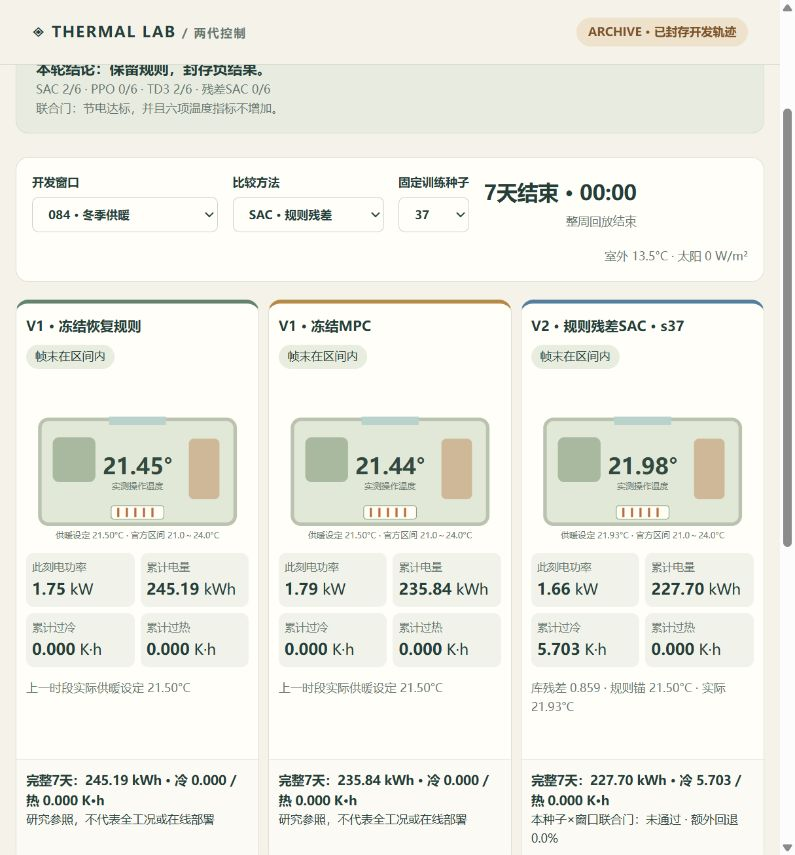

# thermalComfortPredict

楼宇热环境预测与受约束控制研究：从旧热舒适预测实验，重建可复现的建模、控制与强化学习对照流程。

[项目展示](https://xiaofei1412.github.io/thermalComfortPredict/) · [交互回放](https://xiaofei1412.github.io/thermalComfortPredict/replay/) · [项目记录](PROJECT.md) · [最终交付范围](docs/FINAL_STATUS.md)

## 项目目标

在没有自有楼宇硬件的条件下，用公开数据和BOPTEST仿真研究：如何结合人员热需求、建筑热惯性与控制约束，在温度越界不增加时降低耗电，并明确方法的适用边界。

## 项目内容

- **预测基线**：区分热感觉与冷热偏好，重建传统学习、神经网络及物理参照，按来源分组评估。
- **动态建模与MPC**：RC灰箱结合学习残差，预测温度与能耗，加入误差裕量、动作约束和规则回退。
- **强化学习对照**：固定预算与三随机种子，比较SAC、PPO、TD3及规则残差SAC，保留全部正负结果。
- **可交互工作台**：确定性处理人员冷热意图、多人冲突、撤销与过期；公开页面提供45条封存开发轨迹的同步房间回放。

## 主要结果

第一版MPC在9组固定住宅留出仿真对照中节电 **1.62%～9.49%**，温度越界未增加。第二版RL仅有局部开发收益，尚无稳定超越规则/MPC的合格方案，研究按预设停止条件结项。

[第一版研究结果](reports/DELIVERY_V1.md) · [两代对照](DELIVERY_V2.md) · [策略边界](docs/V2_POLICY_CARD.md) · [运行与复现](docs/REPRODUCE_V2.md)

本项目属于有限范围的软件仿真研究；操作温度越界与真实人体舒适分别解释，尚未验证真实楼宇闭环、真实同步数字孪生或Sim-to-Real。公开仓库保留源码、配置、小样例和证据；完整历史数据、模型和轨迹由所有者私有归档。自有代码采用[MIT](LICENSE)，[第三方资产与许可例外](LICENSE_SCOPE.md)独立保留。
