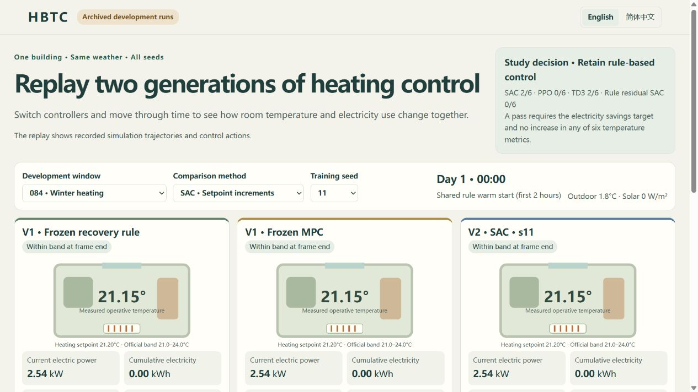

# HBTC · Hybrid Building Thermal Control

**Can a building use less heating electricity without increasing indoor temperature violations?**

HBTC studies heating control in a single-zone home simulated with BOPTEST. A building stores heat, so a setpoint change now can affect indoor temperature hours later. Outdoor weather and solar gains also change when heating is needed. The project compares model predictive control and reinforcement learning as two ways to make that decision.

The work grew from predicting occupants’ reported thermal sensation and preferences. Those predictions address how people feel or what they want. The control study measures electricity use and how far and how long operative temperature falls outside a scheduled band. [Project overview](PROJECT.md)

[Project site](https://xiaofei1412.github.io/thermalComfortPredict/) · [Interactive replay](https://xiaofei1412.github.io/thermalComfortPredict/replay/)

## Model predictive control · Plan with a thermal model

A gray-box model uses thermal resistance and capacitance to represent heat flow and storage. A learned residual corrects the model’s predictions of temperature and power. At each step, MPC forecasts the effects of candidate heating plans, checks them against temperature margins and setpoint limits, and selects a plan using predicted electricity use and setpoint movement. It applies the first action and plans again with new measurements.

The controller can reduce heating early when it predicts that stored heat and solar gains will keep the room warm enough. A recovery rule provides a fallback when conditions fall outside the model’s supported range or no feasible plan is found.

Across nine held-out date and forecast combinations in the simulated home, MPC used **1.62%–9.49% less electricity** than the recovery rule, with no increase in temperature violations. [MPC study](reports/solar_mpc/REPORT.md)

## Reinforcement learning · Learn a setpoint policy

An RL policy learns from repeated simulated heating episodes. The reward penalizes electricity use, temperature violations, and setpoint changes. During evaluation, the policy maps observations and available forecasts to setpoint adjustments. HBTC compares **SAC, PPO, and TD3**, which learn adjustments directly, and **rule-anchored residual SAC**, which learns a bounded correction to a rule-based action. The policies use a fixed training budget and three seeds per method. The comparison aligns forecast access, setpoint limits, and evaluation conditions with the rule and MPC references.

Some SAC and TD3 policies saved electricity in warmer development windows while meeting the temperature criteria. Performance varied by weather and seed. No policy consistently met both criteria against the rule and MPC references, so the RL comparison concluded at the development stage. [RL comparison](DELIVERY_V2.md) · [Policy scope](docs/V2_POLICY_CARD.md)

## Explore the controls

The public replay shows the recovery rule, MPC, and a selected RL policy responding to the same weather. Switch the evaluation window or training seed to compare heating setpoints, temperature, and electricity across 45 archived development trajectories. The separate local workbench lets users submit heating preferences and explore how rules resolve conflicting requests. [Replay guide](docs/DEMO_V2.md) · [Workbench guide](docs/workbench.md)

[Run and reproduce](docs/REPRODUCE_V2.md) · [MIT license](LICENSE) · [Third-party asset terms](LICENSE_SCOPE.md)
