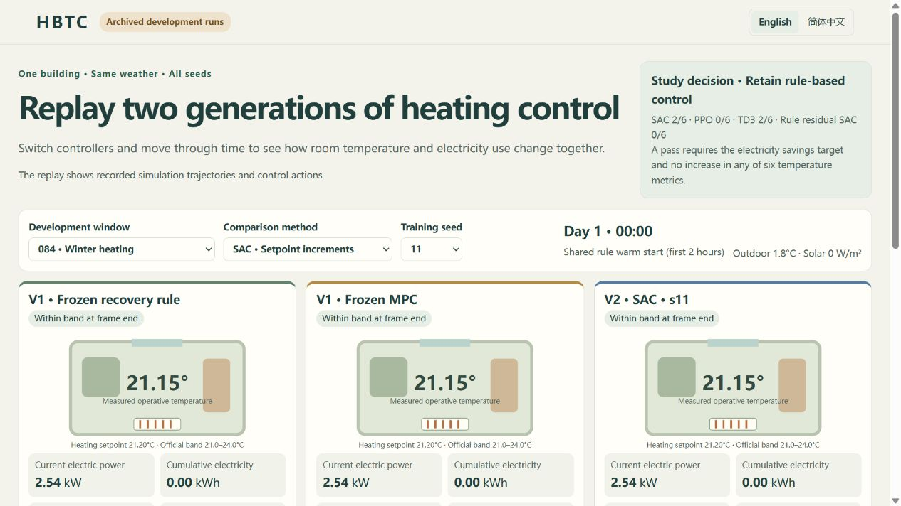

# HBTC：基于灰箱建模的楼宇热环境预测控制与强化学习对照研究

**如何在不增加室内温度越界的前提下，降低供暖用电？**

HBTC（Hybrid Building Thermal Control）以 BOPTEST 单热区住宅仿真为对象。建筑可以蓄热，现在调整供暖设定值，可能数小时后才充分反映在室温上。室外天气和太阳辐射也会改变供暖需求。项目比较两条控制路径，分别用模型预测控制提前规划，用强化学习从仿真交互中学习策略。

项目起于对住户热感觉和冷热偏好的预测。这部分研究关注住户感到冷暖的程度和希望怎样调整。控制研究则衡量耗电，以及操作温度偏离预设区间的幅度和时长。[项目总览](PROJECT.md)

[项目展示](https://xiaofei1412.github.io/thermalComfortPredict/zh-CN/) · [交互回放](https://xiaofei1412.github.io/thermalComfortPredict/replay/?lang=zh-CN)

## 模型预测控制（MPC） · 用热模型提前规划

热阻—热容灰箱模型描述建筑如何传热和蓄热，学习残差用于修正温度与功率预测。每个控制步，MPC 根据天气预报估计候选供暖计划的效果，用温度裕量和设定值限制筛选方案，再综合预测耗电与设定值变化选择计划。控制器只执行首步，收到新测量后重新规划。

如果预测蓄热和太阳辐射足以让房间保持温暖，MPC 可以提前减少供暖。当工况超出模型适用范围或找不到可行方案时，控制器回退到恢复规则。

在该住宅仿真的九组留出日期与预报组合中，MPC 相对恢复规则节电 **1.62%～9.49%**，温度越界未增加。[MPC 研究结果](reports/solar_mpc/REPORT.md)

## 强化学习（RL） · 从仿真交互中学习调节策略

策略在反复的仿真供暖过程中学习，奖励对耗电、温度越界和设定值变化施加惩罚。评估时，策略根据观测和可用预报给出设定值调整。HBTC 比较直接学习调整量的 **SAC、PPO、TD3**，以及在规则动作上学习有界修正的**规则残差 SAC**。每种方法使用固定训练预算和三个随机种子。强化学习、规则与 MPC 在共同预报权限、设定值限制和评估条件下对照。

部分 SAC 和 TD3 策略在较暖的开发窗口中实现了节电，并满足温度指标。收益随天气和随机种子变化，各候选策略未能相对规则和 MPC 稳定达到两项标准，因此强化学习对照在开发评估阶段收尾。[强化学习对照](DELIVERY_V2.md) · [策略适用范围](docs/V2_POLICY_CARD.md)

## 体验不同控制策略

公开回放并列展示恢复规则、MPC 和所选强化学习策略在同一天气下的响应。可切换评估窗口和训练种子，在 45 条封存开发轨迹中比较供暖设定值、温度和耗电。项目也提供本地工作台，可提交冷热偏好并查看规则如何处理相互冲突的请求。[回放说明](docs/DEMO_V2.md) · [工作台说明](docs/workbench.md)

[运行与复现](docs/REPRODUCE_V2.md) · [MIT 许可证](LICENSE) · [第三方资产许可说明](LICENSE_SCOPE.md)
