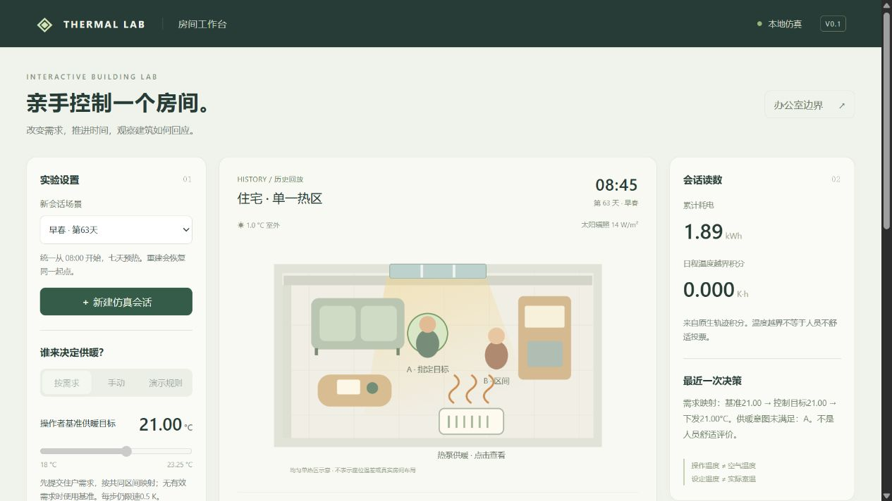

# F：规则工作台＋负结果交付验收

2026-10-27。**源码交付候选资料和规则/离线验收已完成，正式统一授权发行仍有缺口。** 本轮新研究实验、FMU回合、模型重拟合、校准/盲评均0；C2及办公室负结果保持。

## 交付物

- [交付报告](../../DELIVERY.md)、[十分钟演示](../../docs/DEMO.md)、[分层复现](../../docs/REPRODUCE.md)、[发布说明](../../RELEASE_NOTES.md)及[来源条件](../../THIRD_PARTY_NOTICES.md)，保留所有旧研究结论。
- B原始5步会话的无损压缩样例，仅16,034字节；原始SHA与来源随附。启动时校验后安装，已有不同内容的同ID历史不覆盖；后端/前端及研究控制器不改。
- 独立轻量依赖和离线CI，可重算原生轨迹和C2门判定；不需要旧数据、Torch或权重。
- 源码候选zip由Git索引字节制作并逐文件读回验证，排除历史CSV、权重、FMU和outputs；最终包及外部SHA清单在`outputs/delivery-f/thermal-rule-workbench-rc1.zip`及并列`.manifest.json`，不提交二进制。
- 私有本机证据包已实际制作：**4,164文件、原始1,403,578,050字节，zip739,003,972字节**，全部读回核对。完整清单与SHA并列保存在本机；不是异地副本，不上传GitHub。

## 必要验证

1. 新建无system-site-packages的Python3.14 venv，独立安装NumPy2.3.5/Pandas3.0.0/dateutil2.9.0.post0/six1.17.0/tzdata2025.3，`pip check`通过，所有依赖位于新venv。
2. 从排除历史CSV、权重、outputs的源码副本运行；5步/155区间点需求/动作/原生积分与KPI重算通过，最大KPI差3.47e-18，C2的停止判定与84条失败列表一致。只重建已保存门判定，不是从头重训模型。
3. 浏览器实操历史选择、播放到5步、拖回第3步、查看事件/不可行裁决和交付说明；页面明确HISTORY，实时session始终null，导出字节与原样例SHA一致。没有为演示初始化新FMU。
4. **196项完整回归通过**；其中新增6项覆盖离线不触引擎、样例完整性、损坏拒绝、同ID不覆盖及打包取审查索引而非未审查工作区。干净轻量环境独立6项通过；原研究依赖及旧CSV仅用于完整回归。
5. 原C1/C2锁和办公室封存只读核验保持，C2完整旧指标重算通过；只查看已有Docker状态，不重建/中断容器。旧122项首版报告只增加历史快照导航提醒，正文和数值保留。

结构化验收见[verification.json](verification.json)。验收共享操作系统、现有Python标准库和网络，不冒称新机器/新容器从零验收。源码副本地址<http://127.0.0.1:8769>用于本次历史回放；原工作区8768服务继续保留。

## F01～F05核查及当前处置

| 缺口 | 当前状态 | 处理和保留条件 |
| --- | --- | --- |
| F01 代码许可/历史CSV链 | **未关闭** | 不代选许可证；源码候选排除历史CSV，Git既有文件不改；正式授权和数据发行链仍需确认 |
| F02 干净依赖/辅助容器 | **轻量运行闭合，完整部署未关闭** | 独立venv/源码副本通过；版本清单列明全部轻量传递依赖。研究完整依赖及provision/container未作全新重建，不承诺跨平台wheel字节一致 |
| F03 旧工件保存/可获取性 | **本机复制验证完成，异地获取未关闭** | 私有包和逐文件SHA实际读回；仍在同一磁盘，没有经过验收的第三方远程下载入口 |
| F04 wheel范围 | **以源码交付收窄关闭** | 明确不支持独立wheel；源码zip包含页面/报告/样例，按源码根目录运行，不伪装成通用安装包 |
| F05 首拉回放样例 | **关闭** | 真BOPTEST数值样例和来源/摘要随源码，启动器自动安装；无引擎亦可回放及离线核验 |

本轮F资料与工程交付完成，但F01/F02/F03剩余条件使正式发行保持候选状态。下一步只处理许可确认、独立存储/获取及完整部署验收等发布事项；不因此追加住宅/办公室模型攻关、放宽门或消费保护窗口。
