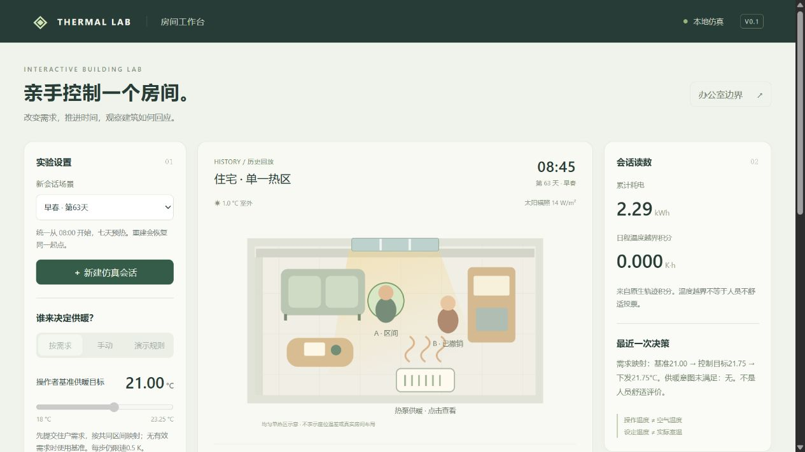

# B阶段：人员意图到供暖控制目标

2026-10-27完成。只接通已有住宅工作台的确定性需求协议，没有新增模型、建筑或研究留出。实现细则见[需求协议](../../docs/demand-protocol.md)，启动与操作见[工作台说明](../../docs/workbench.md)。

## 做了什么，为什么

- 将虚拟住户A/B的更暖、更凉、保持、显式目标和区间，映射为**供暖设定意图**。相对请求锚定提交基准±0.5°C，等优先级可兼容时取共同区间中最接近基准的值；不把屏幕输入解释为真实舒适温度。
- 冲突/执行器不可行时默认阻止推进。操作者可修改、撤销或显式选择A/B/基准；机械范围和限速始终保留，被覆盖请求仍计未满足。供暖不能主动制冷，界面明确能力边界。
- 有效期15～240分钟，按仿真时间到点过期，暂停不消耗期限、快进不续期。需求版本变化使旧裁决失效；新会话清空请求，旧被动偏好不追溯激活。
- 工作台加入提交/撤销、区间/期限、共同目标预览、事件记录和历史回放。schema2保存账本、逐步快照、裁决和分人偏差；同起点规则对照回放相同请求/期限。手动与演示规则明确标识旁路。

## 实际验证

- **164项单元/回归测试通过**，涵盖映射、冲突、有限数值、非法输入、期限边界、旧裁决失效、暂停/在途拒绝变更、历史兼容和新会话隔离；`node --check workbench/app.js`通过。
- `scripts/verify_demand_flow.py`实际运行既有day63演示：源`0a2e84c3cb66`与规则`cbb1ed5f561a`各5步，共10次动作、310个含重复边界原生点。冲突/26°C不可行均HTTP409且没有推进或下发；撤销、精确到期、显式裁决及相同需求快照/期限核对通过。
- 逐区间31点/30秒、真实动作、非负功率、积分与官方KPI核对通过，最大KPI绝对差3.47e-18。紧凑证据[verification.json](verification.json)保留当时版本哈希；完整原生会话在本机`outputs/workbench/sessions/`，不提交Git。
- 浏览器另建`98a50ff4cdf4`，实操双人冲突→选A→撤销B→过期→26°C拒绝→区间需求，3步实际设定21.00/21.50/21.75°C，正常结束保存；检查草稿期限不随历史渲染改变。下面为实际界面，不是概念图。
- 资产清单加入需求模块；办公室封存只读核验保持`closed_negative`，冻结研究源码、数据和权重未修改。

[需求操作区与目标映射截图](controls.png)。以上均为已保存会话的历史回放，控件禁用是只读状态。

## 结论和下一步

B的工程闭环通过。0.5°C、等优先级、期限及裁决是明确约定，不是学习得到的生理规律。设定意图偏差K·h和官方室温越界K·h分开报告；实际供暖设定符合请求，也不代表室温或真实人员舒适已满足。功能检查没有新增节能或舒适改善结论。

对照源含刻意不可行请求，源A/B偏差积分2.75/0.125K·h，规则4.5/0.5625K·h；规则不采纳需求，因此不能据其耗电差宣称等需求满足下节能。C新增必要项C1：先检查目标切换/过期/裁决下的数据覆盖和模型资格，并固定采纳相同需求的共同规则基线，再进行公平控制比较。D模型接入、E独立评估和F发布缺口仍待执行；办公室不重启。
