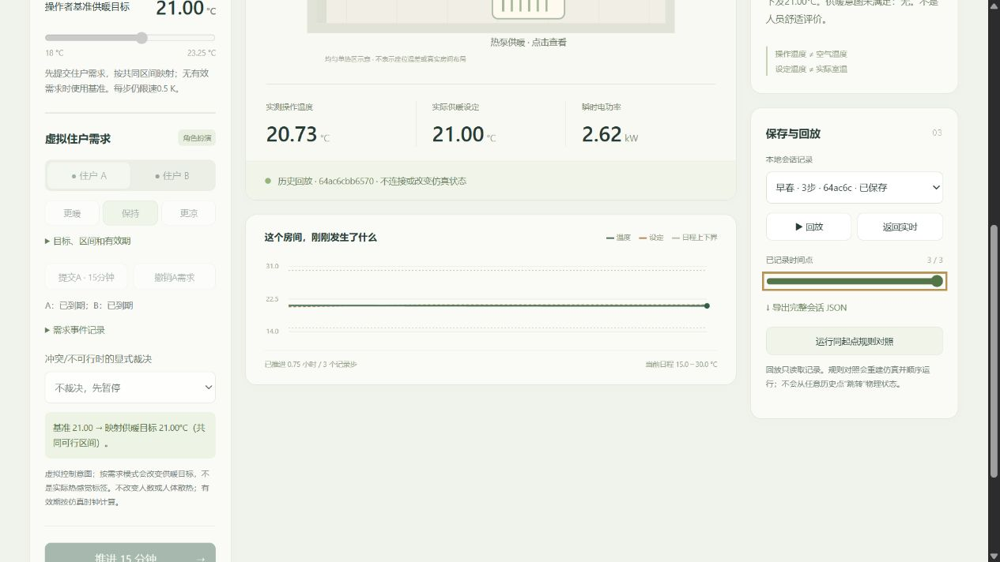

# F02：独立完整部署与旧证据恢复验收

2026-10-27。**F02在Windows amd64 / CPython3.14 CPU＋Ubuntu-24.04 WSL / Docker amd64范围关闭。** 全新源码/依赖/容器组可运行规则工作台，旧证据可从本机档案恢复并只读复核。F01许可、F03异地存储/可获取性尚未关闭；仍为源码候选。

## 做了什么，为什么

上一轮只验收轻量离线运行，完整研究依赖和provision构建尚未闭合。此次固定完整运行包的版本/SHA、固定provision基础镜像和6项依赖，从独立源码副本部署独立服务，避免把开发机既有环境当成可复现交付。复用冻结工作台后端，通过新入口显式指定隔离引擎；没有更改模型、控制规则、门或数据用途。

实施及命令见[部署指南](../../docs/DEPLOYMENT.md)，待所有者决定的许可/档案方案见[清单](../../docs/release-decisions.md)。原F报告作为[上一轮验收快照](../delivery-f/REPORT.md)保留。

## 实际验证

| 检查 | 结果 |
| --- | --- |
| 完整研究依赖 | 新建解析环境下载30个精确wheel；第二个无system-site-packages的空venv，用`--no-index --find-links --require-hashes`安装，30包均在新venv，`pip check`通过 |
| 新源码/上游 | 从rc1源码zip提取，加入本轮列明的部署文件；重新克隆固定BOPTEST提交，Git树干净，FMU及新下载MinIO/mc归档SHA匹配 |
| 容器重建 | 项目`thermal-accept-f2`、引擎8081；storage/provision以`--no-cache`构建，Go实际重新下载依赖；provision锁定Python3.11镜像摘要与6包SHA，`pip check`通过，provision/init退出0，4项服务运行 |
| 三步完整工程链路 | 新工作台8770连接8081；既有day63，冲突409且不推进→确认A→到期→基准/保持→结束。**3动作、93区间点**，动作/30秒采样/原生积分核对通过；四项官方KPI绝对差均0，释放worker |
| 网页 | 选择本轮已保存会话`64ac6cbb6570`，拖至3/3，HISTORY、需求到期、反馈和禁用实时控制显示正确；保存截图 |
| 生命周期隔离 | 仅对新项目执行down/up，全部新容器ID更换、API重新就绪；原项目容器ID/StartedAt不变，8768/8769继续响应；新会话导出与保存文件逐字节不变，无额外FMU动作 |
| 回归 | 独立源码/完整新venv **198项全部通过，17.605秒**；历史两份CSV仅为回归夹具恢复，SHA与原文件一致。新增2项检查引擎地址边界及原默认行为 |
| 本机档案恢复 | 校验原包SHA，将**4,164文件、1,403,578,050字节**恢复至独立源码目录，逐个读取核对，无不同文件覆盖；这不是异地恢复 |
| 恢复后的正式只读流程 | 新venv在恢复副本重算C2 **464动作/14,384区间点**，KPI最大差1.421e-14，原决策/开发分数一致，保护窗口初始化0；办公室封存检查仍`closed_negative` |

结构化证据含源码、日志、原生会话SHA、镜像ID、网络/生命周期及平台信息，见[verification.json](verification.json)。原始日志、新源码、wheel和原生JSON位于`outputs/deployment-f2/`，不提交大工件。新源码候选在提交后的Git索引制作至`outputs/deployment-f2/thermal-rule-workbench-rc2.zip`及并列manifest，保留rc1原包；外部manifest是最终包字节依据。

## 边界与剩余工作

- 共享原Windows/WSL操作系统、Python标准库、Docker守护进程和固定核心镜像层；并非空Docker daemon或新物理机。辅助镜像阶段未复用构建缓存，但不声称可逐字节重建所有镜像或所有平台通用。
- Windows完整研究锁与Linux provision锁各自限定平台；Linux轻量及完整源码回归仍由原CI独立检查，不据此宣称完整Docker部署已覆盖其他系统。
- 新FMU会话仅为已使用day63的工程烟测，不是新的模型实验、节能对照或校准/盲评。重拟合、新研究采集、校准、盲评均0；住宅C2和办公室停止决定未更改。
- F01代码归属/许可与历史CSV发行链、F03目标存储/权限/加密和远程下载恢复待所有者决定。本机恢复通过不能代替异地恢复，不上传完整档案、不创建正式Release。

下一步仅在所有者确认后落实授权和异地获取验收；不因此自动追加算法或场景。
