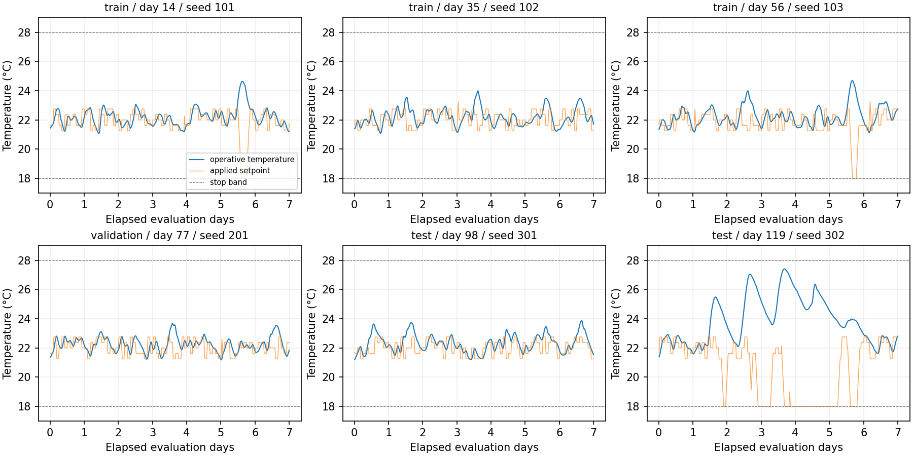
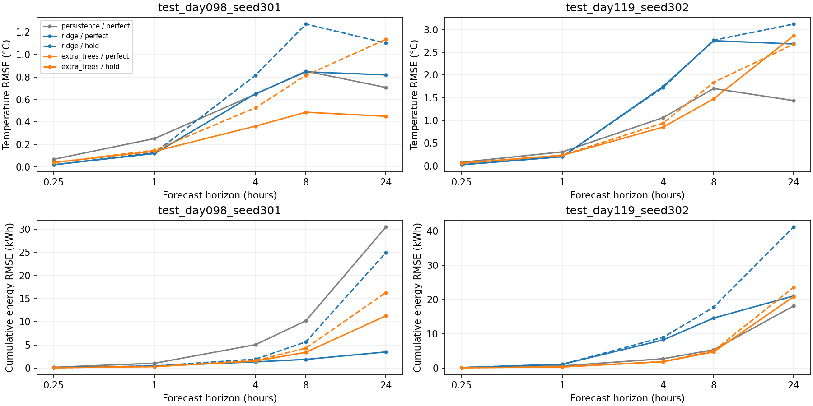

# 带保护激励与动态预测基线结果

日期：2026-10-22，北京时间。固定 BOPTEST 0.9.0、192 m² 单热区地板供暖/热泵模型。实验与复现入口见 [完整协议](../../docs/experiments/dynamics.md)。

**已完成独立激励采集、严格时间/回合隔离，以及不使用未来真实状态的递归预测基线。较短时域有改善，较暖场景和24小时预测仍有明显退化；当前模型不能直接作为可靠 MPC 约束模型。**

## 数据与保护

六个回合各7天，分别以不同种子采集；评测起始模型日为14/35/56（训练）、77（验证）、98/119（测试）。每回合独立内置控制预热7天，连同预热的全部窗口互不重叠。共 **4,032 条15分钟转移、120,966 个原生采样点**，训练/验证/测试原始转移数为 **2,016/672/1,344**。此前内置/规则控制数据未用于本次模型拟合。

计划设定22°C附近五档偏移，每2小时抽样；设定范围18～24°C，变化率≤0.5 K/步。温度接近舒适上下界或中止带时转入恢复/减热模式，记录所有动作。六回合共触发 **17 步恢复、282 步减热、453 步限速**，实际设定覆盖18～23.25°C。

所有原生采样均在18～28°C中止带内，极值为 **21.069～27.406°C**；这不等于始终满足舒适区间。第119日起测试回合的温度越界为 **52.942 K·h**，第14/56日起训练回合分别为2.002/1.934 K·h，其余三回合为0。即使减热，供暖模型也不能主动消除所有太阳得热造成的过热；这里未进行独立因果消融。

## 模型与评测

状态为操作温度、回水温度、供水温度和上一周期耗电。给定状态/动作历史、当前设定及外生量，学习三个温度增量和本周期耗电；多步时用自己的预测递归，不重置为真实中间状态。全部模型共享141个评测起点/回合，时域为15分钟、1/4/8/24小时。

只在训练回合拟合。验证回合按1/4/8小时温度 RMSE 均值选择，Ridge 选中 **lag=8、alpha=0.1**，ExtraTrees 选中 **lag=8、leaf=2、128棵树**；两者各使用1,992个训练窗口。候选和参数范围预先固定，验证数据未参与拟合或重拟合。持久性保持起点温度和上一周期耗电。

以下为确定性完美天气、给定已执行未来动作时，时域**末端操作温度 RMSE（°C）**。未来动作中包含真实闭环保护响应，因此属于已执行动作条件下的离线预测，不是任意候选动作的反事实验证。

| 测试起始日 | 模型 | 15 min | 1 h | 4 h | 8 h | 24 h |
| --- | --- | ---: | ---: | ---: | ---: | ---: |
| 98 | 持久性 | 0.0676 | 0.2531 | 0.6478 | 0.8529 | 0.7079 |
| 98 | Ridge | 0.0189 | 0.1195 | 0.6521 | 0.8468 | 0.8198 |
| 98 | ExtraTrees | 0.0386 | 0.1388 | 0.3635 | 0.4871 | 0.4509 |
| 119 | 持久性 | 0.0779 | 0.3079 | 1.0622 | 1.7025 | 1.4363 |
| 119 | Ridge | 0.0240 | 0.2010 | 1.7493 | 2.7551 | 2.6835 |
| 119 | ExtraTrees | 0.0585 | 0.2318 | 0.8543 | 1.4749 | 2.8633 |

Ridge 一步最准确，但长时没有稳定优势。ExtraTrees 在两个测试回合的4小时误差较低，较暖回合24小时则差于持久性，不能只凭短时误差选择长时 MPC 模型。

同一条件下的**累计耗电 RMSE（kWh）**：

| 测试起始日 | 模型 | 4 h | 8 h | 24 h |
| --- | --- | ---: | ---: | ---: |
| 98 | 持久性 | 5.080 | 10.240 | 30.423 |
| 98 | Ridge | 1.372 | 1.907 | 3.514 |
| 98 | ExtraTrees | 1.554 | 3.438 | 11.298 |
| 119 | 持久性 | 2.709 | 5.328 | 18.065 |
| 119 | Ridge | 8.200 | 14.565 | 21.011 |
| 119 | ExtraTrees | 1.825 | 4.707 | 20.791 |

Ridge 在第119日起测试回合的4小时预测路径上，**59.22%** 的逐区间耗电预测为负；第98日起回合为10.99%。没有裁剪这些值，误差表和负值比例均保留。不能直接把该耗电预测放进优化目标，否则优化器可能利用非物理解。ExtraTrees 此次没有负耗电，但并不因此获得任意动作下的物理正确性保证。

## 未来天气与分布变化

将未来室外温度和太阳辐射冻结在预测起点（其他未来信息相同），ExtraTrees 的4小时温度误差变为 **0.5274/0.9427°C**（第98/119日起回合），8小时为0.8160/1.8382°C。该条件与完美天气分别报告；不同条件不保证每个场景/时域的误差单调变化。

图中时域横轴为对数刻度；实线为完美天气，虚线为冻结起点天气。

第119日起回合约 **66.37%** 的区间起点外温、32.44%的区间末端操作温度落在训练回合观察范围之外；这是模型外推风险的直接证据。它与长时退化同时出现，但本次未通过控制变量实验确认全部误差来源。Ridge 历史状态递归矩阵谱半径为0.9363；小于1仍没有阻止有偏差的长时预测。

两个测试回合分别保留，不把重叠起点当作独立重复实验，不报告跨建筑置信区间。全部结果仍来自同一已知仿真建筑和确定性天气年。

## 验证与工件

- **37项离线测试通过**：既有23项 + 新增14项，覆盖温度保护、限速、中止、时序/回合隔离、数据摘要、训练专用缩放、递归输入、防未来状态泄漏、天气信息条件及负耗电统计。
- 6回合的原始工件摘要、时间连续性、实际动作与原生采样均通过核验；独立积分与官方四类 KPI 最大绝对差 **7.11e-14**。保护模式和计划动作按种子逐步精确重放。
- 六个回合分别新建 FMU 的短时冒烟与正式运行首6小时数值精确一致；未重复验证完整7天仿真。
- 模型保存重载后，重新计算所有验证/测试时域、模型和天气条件的指标，与原结果一致。独立进程再次拟合和评测，选参、切分、逐起点误差与全部指标**数值精确一致**。
- 图像已查看，坐标单位、图例与曲线显示正常。历史预测资产和上一阶段结果没有重写。

| 紧凑工件 | 用途 |
| --- | --- |
| [metrics.csv](metrics.csv) / [selection.json](selection.json) | 所有时域/信息条件指标，8个候选及验证选择 |
| [split_manifest.json](split_manifest.json) / [evaluation_origins.json](evaluation_origins.json) | 回合、预热、角色、源摘要及全部评测起点 |
| [coverage.csv](coverage.csv) | 训练回合范围与每回合范围外比例 |
| [rollout_examples.csv](rollout_examples.csv) | 各评测回合第一固定起点的24小时曲线，预先按索引选取 |
| [collection_metrics.csv](collection_metrics.csv) / [collection_safety.json](collection_safety.json) | 六回合采集指标、干预与温度极值 |
| [excitation_samples.csv](excitation_samples.csv) | 六回合首日转移样例，共576条；不是额外独立数据 |
| [verification.json](verification.json) / [collection_verification.json](collection_verification.json) | 重载、独立重训、保护重放、原生积分和短时复现证据 |
| [manifest.json](manifest.json) / [provenance.json](provenance.json) / collection_*.json | 配置、依赖、固定 FMU、代码及本地工件摘要 |

完整轨迹位于 `outputs/excitation/`，模型及逐起点误差位于 `outputs/dynamics-baseline/`，独立重训位于 `outputs/dynamics-repeat/`，均不提交 Git。初轮开发输出 `outputs/dynamics/` 未作为正式工件，正式版额外报告水路误差和覆盖率，未改变候选、切分与选参目标。

## MPC 准备情况与下一步

模型工件和 `rollout()` 接口已可接收候选设定序列与外生序列，并输出递归温度和区间能耗；所需测量状态、单位和维度已明确。**尚未完成可靠模型的验收或任何 MPC 闭环收益验证。**

下一步先修正能耗物理约束，检查候选动作对真实 FMU 的响应，并在受支持动作范围、较短预测时域内定义误差裕量与回退控制，再接入短时域 MPC 对照。较暖工况和过热作为明确的压力测试保留，不能通过删除失败测试回合提高结果。
