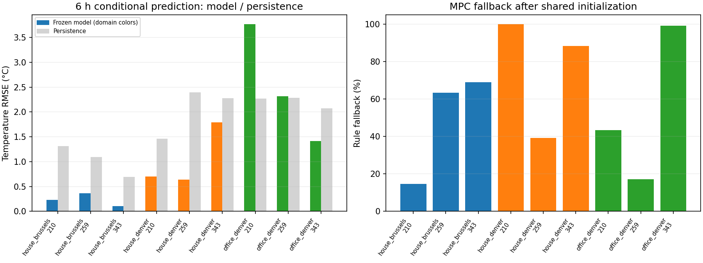
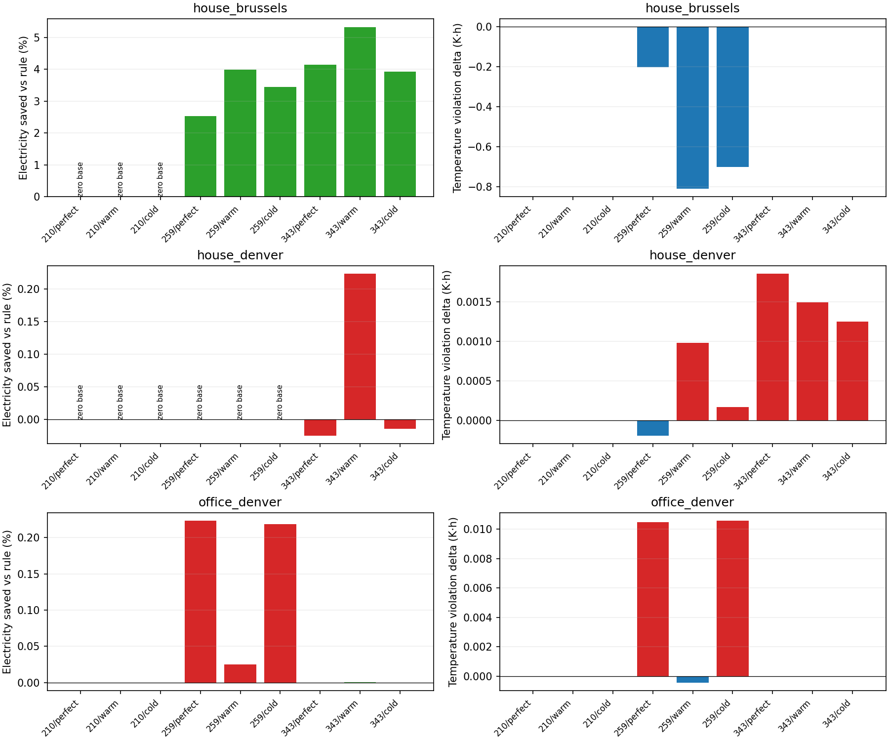

# 冻结控制器的跨天气、跨建筑仿真泛化

日期：2026-10-25。固定协议见[实验说明](../../docs/experiments/generalization.md)，全部逐组结果见[对照表](results_table.md)。本轮只测试迁移，不根据目标结果改模型、裕量、回退或动作界限。

## 冻结对象与来源

- 基线提交：[d156645](https://github.com/xiaofei1412/thermalComfortPredict/commit/d156645b93cd289081b1c8f0755b65121a9c83b0)。冻结2R2C＋残差、执行器、电量映射、6小时MPC、8小时停热投影及全部规则参数。
- 模型SHA-256：`ffcbeb0b4c41199ce8642d91967c200a1711a0e61baf23ffc74bb94ce3ce8f17`，与上一轮正式模型一致，目标训练行数为零。冻结UTC时间为2026-10-25 07:49:34，早于目标控制评测。
- BOPTEST 0.9.0源码固定于`9b1610bf7a108826bb3d22c72bffd2d71d7bb0a9`。原住宅FMU摘要为`674b9500c1c89fdbec64f2c053af8ddcd06afebe63bd7c1b7fc708692a11863e`；办公室官方FMU为`158008fa3b635280a67dfed8bab5804d1f9a96d218b467dfebab77e5cbf8b86a`。生成的迁移FMU摘要及全部源码摘要见[冻结清单](freeze.json)。

| 测试域 | 建筑/末端 | 实际天气 | 温度指标 | 能源指标 |
| --- | --- | --- | --- | --- |
| house_brussels | 192 m²住宅，辐射地板/热泵 | 布鲁塞尔原年度 | 操作温度 | 热泵、风机与循环泵电耗 |
| house_denver | 同住宅，编译模型不变 | 丹佛TMY | 操作温度 | 同上 |
| office_denver | 48 m² BESTEST Case900办公室，风机盘管/燃气锅炉/冷水机 | 丹佛TMY | 空气温度 | 风机与冷却电耗、官方燃气能量分列 |

丹佛资源来自同版本[官方bestest_air案例](https://github.com/ibpsa/project1-boptest/tree/9b1610bf7a108826bb3d22c72bffd2d71d7bb0a9/testcases/bestest_air)，头部标识Denver-Stapleton TMY--23062/WMO724690；不是新观测年份。天气迁移替换实际MOS和预报CSV，FMU二进制、模型描述与住宅日程不变；经纬度和太阳几何另核查。上游代码许可见[BOPTEST许可](https://github.com/ibpsa/project1-boptest/blob/9b1610bf7a108826bb3d22c72bffd2d71d7bb0a9/license.md)，天气沿用上游随附资源，不单独重授权；大体积FMU、天气与原始轨迹不提交到本仓库。

## 固定设计与公平性

三个域×day210/259/343×完美API预报/偏暖/偏冷×规则/MPC，共54个7天回合。三个新窗口连同7天预热为[203,217)、[252,266)、[336,350)，与此前训练、验证和正式测试窗口不重叠。原day238/273/315测试归档保留，本轮没有拿它们继续调参，也没有重跑其完整FMU回合后声称新证据。

每支6天内置预热＋1天22°C共同预序列，随后重置控制器观测器。预序列不计正式能耗，另存原始数据；官方KPI包含预序列，所以使用相同完整时间窗独立积分核验。两控制器在相同域/日期的初始化、预序列、真实外生和前8步必须一致；规则跨三种预报应相同。

办公室只映射明确的输入/输出：热设定、空气温度、供热观测。根据该FMU的`FanCoilUnit_T`及XML默认`eff=0.9`，供热观测取0.9×官方GasPower。内置冷却策略保留，两控制器相同；源模型没有冷却状态，也没有重拟合燃气末端或电量映射。**这是存在指标语义、建筑尺度和末端变化的零目标训练压力测试，不能解释为同一种温度模型已无缝迁移，也不能把热泵电费目标当作办公室总成本优化。**

冻结的是参数和控制逻辑，原有因果观测器仍根据已发生的目标温度与供热更新潜在状态；零训练不代表不需要目标测量。运行脚本没有调用拟合或重标定入口。

每组严格要求电耗下降，同时总越界、过冷、过热、越界时长、最大冷热偏差均不增加，办公室还要求燃气和总终端能量不增加，容差固定1e-6。零电耗基线没有可报告的节电百分比；中止回合不比较不同长度积分。温度指标不等于人员主观热感觉或偏好。

## 结果

54个7天回合全部完成，无中止，共36,288条15分钟转移、1,088,694个原生点。**源气候的新日期仍有节电价值，但没有得到稳定、实质性的跨气候或跨建筑迁移收益。** 27组中7组通过预先固定的全部门槛，不能将这个描述性计数解释为独立随机成功率。

| 域 | 全部门槛通过 | 非零电耗基线组数 | 主要结果 |
| --- | ---: | ---: | --- |
| 原住宅/布鲁塞尔 | 6/9 | 6 | 两个供暖日期的三种预报均达标，节电2.53%～5.32%；夏季三组均零电耗，仍过热，不计节电成功 |
| 原住宅/丹佛 | 0/9 | 3 | 夏季与过渡季六组零电耗仍过热；冬季节电−0.0250%～+0.2233%，三组均有微小越界增加 |
| 办公室/丹佛 | 1/9 | 9 | 唯一通过组仅节电0.000570%，约0.000100 kWh，不能作为有实际意义的迁移节能证据 |

完美API预报下的典型对照：

| 域/日期 | 规则/MPC电量 kWh | 规则/MPC燃气 kWh | 规则/MPC温度越界 K·h |
| --- | ---: | ---: | ---: |
| 布鲁塞尔住宅/259 | 114.921/112.008 | 0/0 | 1.811/1.609 |
| 布鲁塞尔住宅/343 | 306.060/293.370 | 0/0 | 0/0 |
| 丹佛住宅/210 | 0/0 | 0/0 | 812.018/812.018 |
| 丹佛住宅/343 | 258.660/258.724 | 0/0 | 12.668/12.670 |
| 丹佛办公室/259 | 50.114/50.002 | 5.340/4.759 | 3.463/3.474 |
| 丹佛办公室/343 | 17.567/17.567 | 108.527/108.527 | 1.140/1.140 |

丹佛住宅day259也是零电耗，仍约228.432 K·h过热；这不证明物理上不存在其他控制手段，只说明本次供暖动作集合没有消除过热。办公室day259完美预报虽然电与燃气均少用，但越界增加约0.01048 K·h，按原门槛不通过。

部分判定取决于极小差别，例如办公室day259偏暖预报的总越界下降，但最大过热增加约0.000017 K，仍按固定1e-6门槛判为失败。夏季零供暖轨迹也存在微小数值差异。**保留严格判定，不把这些微差解释为有统计或工程意义的恶化/改善**；没有看到跨域稳定的显著节电，是比通过组数更重要的结论。

## 预测与回退的解释

每回合157个起点，从第16步起每4步取样，自由滚动15分钟、1小时、6小时、8小时；起点之后不回填真实温度或供热。记录的未来动作是条件输入，分别用完美API视图和受扰预报视图评测，属于事后条件预测，不能当作未来动作已知的在线能力。所有起点有相关性，不当作157个独立建筑实验。

电量误差以累计kWh报告，温度误差以°C报告；办公室空气温度与住宅操作温度分别列示，不混合排名。经验裕量保持源域标定值，报告实际覆盖，不重新拟合。API的“完美”预报也有插值/采样差异，实际气象测量与CSV预报的误差在`decision_audit.json`单列，不能称逐点零误差。

回退比例同时列出全部672步与去掉共同前8步后的664步分母；优化、提前停热、支持范围外、无可行计划分别计数。大量回退的闭环收益归属于整个组合策略，不能全部归功于学习模型。

以下使用**规则轨迹、完美API预报视图、6小时条件预测**；回退列为同日期完美预报下MPC的664步分母。住宅为操作温度，办公室为空气温度；不对两种温度混合排名。

| 域/日期 | 模型温度RMSE °C | 持久性RMSE °C | 冻结裕量覆盖 | 累计电量RMSE kWh | MPC回退 |
| --- | ---: | ---: | ---: | ---: | ---: |
| 布鲁塞尔住宅/210 | 0.230 | 1.315 | 100.00% | 0.002 | 14.61% |
| 布鲁塞尔住宅/259 | 0.364 | 1.094 | 96.18% | 1.231 | 63.25% |
| 布鲁塞尔住宅/343 | 0.103 | 0.690 | 100.00% | 1.952 | 68.98% |
| 丹佛住宅/210 | 0.700 | 1.459 | 77.07% | 0.002 | 100.00% |
| 丹佛住宅/259 | 0.639 | 2.399 | 84.08% | 0.474 | 39.16% |
| 丹佛住宅/343 | 1.791 | 2.279 | 36.94% | 5.719 | 88.40% |
| 丹佛办公室/210 | 3.770 | 2.272 | 26.75% | 3.080 | 43.37% |
| 丹佛办公室/259 | 2.314 | 2.282 | 38.85% | 4.427 | 17.17% |
| 丹佛办公室/343 | 1.412 | 2.077 | 55.41% | 15.654 | 99.10% |

覆盖率是对应预测端点的经验覆盖，**不是整段联合覆盖或概率安全证书**。丹佛住宅模型仍优于持久性，但原裕量已明显不足；办公室前两日期还差于持久性，冬季电量映射误差很大。仅输入落在原支持盒内，并不证明温度语义、围护结构或末端动态可迁移。全部预报/控制轨迹的1/4/24/32步误差与偏差见[prediction_metrics.csv](prediction_metrics.csv)，各模式与回退原因见[decision_audit.json](decision_audit.json)。

## 验证与局限

- 76项离线测试通过，编译检查通过。新增7项覆盖接口语义、能源载体、冻结内容篡改、严格验收与CSV夜间全零列的显式浮点模式。
- 源码/配置/模型/FMU摘要、无目标训练、全部网格、隔离窗口、两控制器相同预序列/前8步与规则跨预报不变性核验通过。
- 全部36,288步正式决策重放，容差1e-10；实际动作、限幅/限速和原生边界核验通过。原生温度范围20.091～33.723°C，没有越过固定中止带，不代表舒适达标。
- 独立积分核验全部正式回合的能源与温度KPI，包含共同预序列的同时间窗最大API绝对差5.684e-14；正式表格单独排除预序列。
- 54支独立首6小时共1,296步、38,934原生点与正式轨迹前缀数值精确一致，完整存档摘要也核验通过。**未独立重跑完整7天。**
- 首次前缀检查因全零辐照CSV被推断为整数、完整CSV为浮点而失败；显式固定数值列为浮点后增加回归测试，重新执行完整审计。没有更改FMU、参数、轨迹、数值容差或验收门槛。
- 两张结果图已查看，图例、坐标与标注正常；[验证清单](verification.json)、[重复存档检查](repeat_archive_checks.json)与[来源/环境摘要](provenance.json)保留完整证据。

本轮是两个特定FMU、两份气象资源和三个新日期的仿真评估，日期、天气误差模式与确定性重复不是独立随机样本，不据此计算跨楼宇成功概率或年度节电率。供热观测依赖FMU读数，办公室供热还经过已知固定效率换算；真实楼宇是否可观测尚未解决。住宅无主动制冷，办公室则使用自身内置冷却，不能直接比较两域绝对过热量。没有真实数据离线校准、真实楼宇闭环或已验证Sim-to-Real结论。

下一步保留本轮27组为回归，先用另外的目标域开发/校准数据建立匹配末端、能源载体与温度语义的模型，明确冷却作用，重新评估误差界与回退；之后再冻结到全新时间留出。不能在这27组上调完参数后重新称盲测，也不宜立即以更复杂网络或RL替代这些必要适配。
