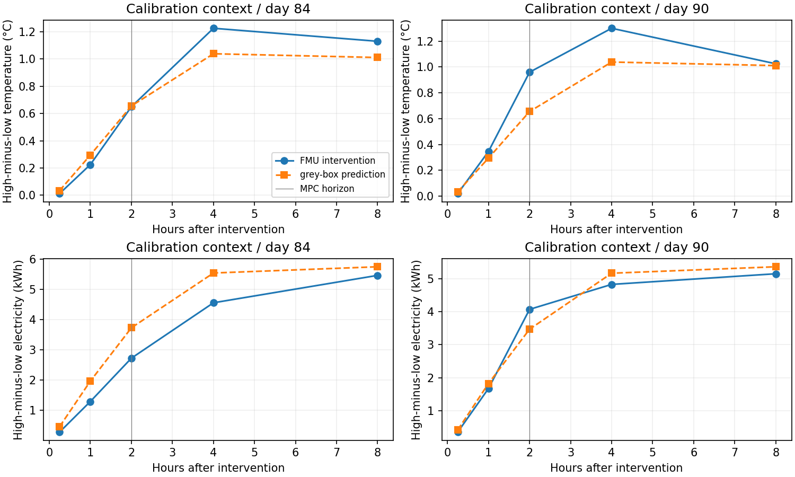
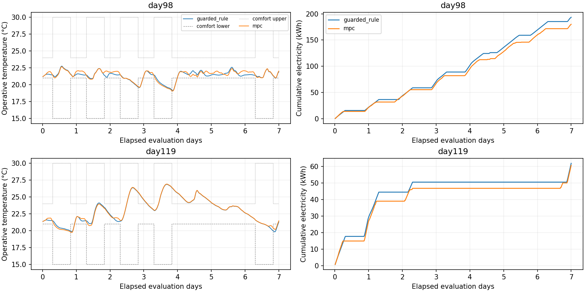

# 灰箱残差模型、动作响应与短时 MPC

日期：2026-10-22，北京时间。BOPTEST 0.9.0、192 m²单热区地板供暖案例。复现命令、方程、角色和保护定义见 [实验协议](../../docs/experiments/mpc.md)。

**已跑通正参数2R2C灰箱加学习残差、结构性非负耗电、成对FMU动作干预，以及有误差裕量和回退的2小时MPC。两个7天窗口的耗电降低，但温度越界略增，不能宣称整体优化或严格安全成功。**

## 模型与隔离

三个既有激励训练回合用于辨识，测试回合不拟合。验证回合前3天的65个起点选择残差权重，中间留出1天，后3天的71个起点估计逐步误差裕量。全部参数与控制配置在正式控制对照前固定，没有按控制测试成绩继续调参。

2R2C采用正R/C和精确离散化；Ridge学习有界温度残差，验证选择权重1。执行器使用受约束的供热递推，耗电使用非负回归。拟合参数 Rza/Rzm 为3.120/0.136 K/kW，Cz/Cm为2.185/11.432 kWh/K；它们是简化模型参数，未经真实建筑物性标定。

在与上一阶段相同的141个起点/回合上，给定已执行未来动作和完美外生量，自由预测结果如下：

| 测试起始日 | 模型 | 2h温度 RMSE °C | 4h温度 RMSE °C | 2h累计耗电 RMSE kWh |
| --- | --- | ---: | ---: | ---: |
| 98 | 纯RC | 0.4121 | 0.6271 | 0.7383 |
| 98 | RC＋残差 | 0.4220 | 0.6398 | 0.7279 |
| 119 | 纯RC | 0.5555 | 0.8842 | 0.6663 |
| 119 | RC＋残差 | 0.5330 | 0.8388 | 0.6641 |

残差改善了验证选择目标和较暖测试回合，但没有普遍提高温度精度。新模型不再预测供回水温度，使用已完成区间的供热观测；与旧模型的输入传感器不同，不能把差异全归因于模型结构。

所有报告的预测耗电均非负，这是基函数/系数约束的结果，旧Ridge基线的负预测仍保留作历史对照。非负不是完整物理正确性：功率模型在零预测供热时仍有约0.30 kW基准项，存在空载偏差。

## 独立动作响应

第84/90日起各运行三支独立FMU，7天内置预热后执行相同2小时预序列，再分别保持21.5/22/22.5°C共8小时。六支共240条转移、7,206个原生点；干预起点全部返回状态精确一致。

高档22.5°C减低档21.5°C的2小时响应：

| 校准情境 | 实际温差 °C | 预测温差 °C | 实际耗电差 kWh | 预测耗电差 kWh |
| --- | ---: | ---: | ---: | ---: |
| day84 | 0.6498 | 0.6553 | 2.7254 | 3.7322 |
| day90 | 0.9598 | 0.6553 | 4.0691 | 3.4691 |

两情境方向检查和非零响应门槛通过，模型能识别这个干预范围的升温/耗电方向，但幅度有误差。该门槛只检查这两个校准情境的2小时高低档差，**不是全部候选动作的反事实准确性证明**。

## 裕量与闭环对照

逐步温度裕量为时间留出的验证后段绝对误差95%分位数加0.1 K，从15分钟的0.273 K增至2小时的0.742 K。既有激励测试回合的2小时实际覆盖率只有 **89.36%/85.11%**，未保持95%；它是经验裕量，不是概率或安全保证。

MPC每15分钟在最多81个两步分块候选中重规划2小时，只执行首动作；计划温度需满足收紧后的官方舒适上下界，动作与变化率受约束。初始化、模型支持范围之外、无可行计划、预测非法或温度保护均触发规则控制。两控制器共享温度保护、18～23.25°C动作界限、0.5 K/步及相同FMU初始化/预热和确定性完美外生数据。

正式对照四回合各7天，共 **2,688条转移、80,644个原生点**：

| 起始日 | 控制器 | 总耗电 kWh | 温度越界 K·h/zone | 成本 EUR/m² | MPC接管步数 |
| --- | --- | ---: | ---: | ---: | ---: |
| 98 | 带保护规则 | 193.314 | 7.9153 | 0.255235 | — |
| 98 | MPC＋回退 | 180.002 | 7.9661 | 0.237660 | 499/672（74.26%） |
| 119 | 带保护规则 | 61.954 | 39.4116 | 0.081799 | — |
| 119 | MPC＋回退 | 60.687 | 39.9779 | 0.080126 | 163/672（24.26%） |

MPC组合控制器分别少用电 **6.89%/2.05%**，温度越界增加 **0.0509/0.5663 K·h**。未做统计显著性检验，没有同时改善两个目标。规则只用当前日程，MPC使用未来2小时信息，结果包含信息利用方式的差异。

day98的非MPC决策包括43步温度恢复、91步超出模型支持范围、32步无裕量可行计划、7步初始化；day119分别为27步恢复、154步减热、313步支持范围检查、7步无可行计划、8步初始化。较暖场景的大部分表现来自回退，不能全部归功于MPC优化。

四回合原生温度均在18～28°C中止带内，实际极值约19.074～26.920°C；官方舒适区间仍有违反。供暖执行器不能主动制冷，中止带与舒适约束不是同一概念。

MPC实际接管时的一步温度 RMSE 为0.116/0.049°C，首步裕量覆盖95.79%/100%；这些是经过可行性和支持范围筛选后的子集统计，不代表全工况保证。MPC决策耗时p95约2.20/2.01 ms，只含策略调用，不含通信、测量和FMU。

## 验证证据

- **51项离线测试通过**（原37＋新增14），覆盖热网络稳定/正性、耗电非负与单位、动作即时响应、未来真实温度/供热不泄漏、候选边界/分块/限速、非法预测/不可行/OOD回退、共同保护、JSON日志和中止。
- 模型重载后重算全部离线指标、残差选择与裕量；独立进程重新辨识/拟合，参数摘要、选择、裕量、覆盖率和指标数值精确一致。
- 六支干预和四支控制的全部动作、控制理由与预测计划离线重放一致（数值容差1e-10，排除墙钟耗时）；实际动作/变化率、同一初始化、共同8步预序列、相同外生数据与原生中止带核查通过。
- 所有原始文件摘要、转移对齐和KPI重算通过；能耗、温度越界、成本、排放与官方API的最大绝对差 **5.69e-14**。
- 四支首6小时FMU冒烟与正式运行轨迹数值精确一致，未重复运行完整7天。所有本次testid均在结束后释放。
- 两张图已查看，坐标、图例与曲线正常。CI运行离线测试，真实FMU集成验证在本地完成。

## 工件与限制

紧凑证据包括 [comparison.csv](comparison.csv)、[greybox_metrics.csv](greybox_metrics.csv)、[greybox_selection.json](greybox_selection.json)、[greybox_margin_coverage.csv](greybox_margin_coverage.csv)、[response_response_metrics.csv](response_response_metrics.csv)、[response_response_gate.json](response_response_gate.json)、[decision_audit.csv](decision_audit.csv)、[verification.json](verification.json) 及来源/摘要文件。首日样例不是额外独立测试集。

完整模型/轨迹位于本地 `outputs/greybox-mpc/`、`outputs/greybox-repeat/`、`outputs/action-response-final/`、`outputs/mpc/`，不提交Git。初始化隐藏状态依赖近似，供热观测在真实建筑中也需要传感或估计器；本次未测试天气预报误差、传感噪声、通信故障或跨建筑迁移。

下一步应扩充工况覆盖、改进回退期间的舒适恢复和空载能耗模型，验证天气误差与更多干预动作。现有仿真链路已贯通，人员需求预测模型尚未接入控制，可靠性验收和真实迁移仍未完成。
