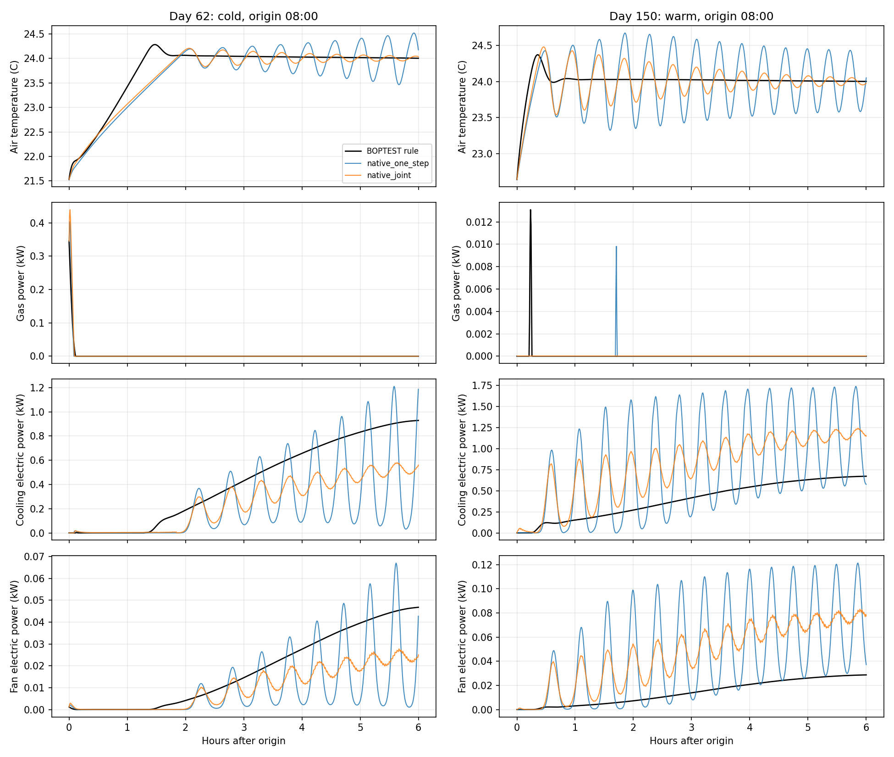

# 原生末端辨识与联合多步训练：开发门未通过

本轮完成原生30秒辨识、温度/三类功率联合多步训练、分季节/能源能力门及规则轨迹验证。**两个候选都未取得部署资格，保持规则控制；未生成新校准集，未开展未使用场景测试。** 没有因失败降低门槛，也没有使用旧正式测试调模型。协议见[预设范围与门槛](../../docs/experiments/native_terminal.md)。

## 模型与数据

基线为`e537267`及上一轮冻结的15分钟静态末端模型。新模型使用30秒2R2C、两个PI记忆、冷却迟滞、风量一阶动态和非负风机功率多项式。已知结构来自固定BOPTEST 0.9.0上游`9b1610bf7a108826bb3d22c72bffd2d71d7bb0a9`的`Thermostat_T.mo`、`ControlToTemperature.mo`、`FanCoilUnit_T.mo`，不是从零学习控制器。联合更新14个有界热网络/末端/功率参数，不增加神经网络。参数详见[模型参数](model_parameters.json)。

空气温度单位°C，燃气/制冷电/风机电功率kW，累计能源kWh。供暖效率0.9、制冷COP3，风机不向空气加热。30秒用于预测和辨识，供暖动作仍15分钟更新；动作18～23.25°C、每步限速0.5K，18～35°C中止带。仍只覆盖供暖设定值，内置制冷、风机、送风不覆盖。操作温度、主观热舒适标签和当前空气温度不混用。

| 用途 | 日期与数据量 | 本轮是否新采 |
| --- | --- | --- |
| 训练 | 丹佛24/94/124/328各3天；34,560个30秒区间、34,564点 | 复用上一轮训练角色原生数据 |
| 激励开发 | 丹佛62/150各3天；17,280区间、17,282点 | 复用上一轮选模角色，不是正式测试 |
| 主要规则开发 | 同一62/150，各3天；576次动作、17,280原生区间、17,282点 | 新执行，日期仍是既有开发日期，无新增时间独立性 |
| 成对响应 | 两日期×20.5/23.25°C，各半天，共2天、5,764点 | 复用既有开发干预 |
| 规则独立前缀复跑 | 两日期各6小时，共48次动作、1,442点 | 新执行；未重复整个3天 |
| 新校准/未使用场景 | 0天 | 开发未通过，均未启动 |

训练/开发角色及7天初始化按时间分块隔离，跨季节交错，不称全年未来先后切分。所有拟合和能力验证仅使用上述开发来源；旧校准和正式测试只核验冻结摘要，不用于损失、选模或能力门。数据源为固定版本BOPTEST仿真，来源/文件摘要见[数据台账](data_ledger.json)、[源开发清单](source_development_manifest.json)及[审计](audit.json)。第三方许可沿用[原部署记录](../../docs/experiments/simulation.md)，上游源码保留其`license.md`；本轮不分发FMU或大型原生数据，不推定第三方数据适用本项目代码许可。

两个预定候选：`native_one_step`先联合辨识30秒温度和功率；`native_joint`从该结果出发，联合训练30秒、5/15分钟、1/6小时自由滚动温度、端点功率及梯形累计能源。前者3,264个训练起点，后者128个重叠起点，分别59/19次目标函数评估后收敛。不同目标的cost不直接排名。两者都只用同一12天训练，未按开发失败追加损失/候选或改门槛。

每个起点只使用已发生的温度、功率、风量和历史动作重建PI/蓄热状态；**未来记录动作和公开预报是条件输入**。这不是独立预测未来规则动作，也不等于反事实候选动作普遍准确。自由滚动不插入未来实测中间温度、功率或风量。30秒区间使用端点梯形积分，旧模型仅比较合法的1/6小时温度和累计能源，不把旧区间平均功率伪装为5分钟端点预测。

## 改善与未通过项

在同一规则轨迹上，每日期63个每小时起点（重叠、不独立）；6小时RMSE如下。完整激励、短时功率、偏差及阈值见[312行指标](prediction_metrics.csv)、[144行能力门](capability_gates.csv)、[季节/能源汇总](capability_matrix.csv)及[结果表](results_table.md)。

| 开发季节 | 模型 | 温度°C | 燃气kWh | 制冷电kWh | 风机电kWh |
| --- | --- | ---: | ---: | ---: | ---: |
| 冷季62 | 原冻结静态 | 0.568742 | 1.627917 | 0.507448 | 0.041901 |
| 冷季62 | 原生单步 | 0.579148 | 1.375905 | 0.573137 | 0.025759 |
| 冷季62 | 原生联合 | **0.528901** | **1.240074** | 0.522609 | **0.025738** |
| 暖季150 | 原冻结静态 | 0.840621 | 0.107045 | 1.450206 | 0.091503 |
| 暖季150 | 原生单步 | 0.502299 | 0.050053 | **1.159196** | 0.094364 |
| 暖季150 | 原生联合 | **0.484290** | **0.036353** | 1.265100 | 0.099868 |

原生联合相对同结构单步训练改善温度和冷季燃气，但暖季制冷/风机能量误差反而变大。相对原冻结模型，多项温度/燃气预测改善，仍不能得出模型足够支持优化控制的结论。

温度1/6小时的8个门两候选均通过；包括功率、能量、活动样本和起点数量的72个门，单步通过37个、联合41个；另两项响应各通过1项。**没有任何一个季节的所有能源门同时通过，也没有候选通过全局资格。** 数门数量仅作诊断，不能作为统计显著性或按总票数部署的依据。

主要失败包括：

- 冷季规则的6小时制冷电量RMSE：联合0.522609kWh，真实累计量RMS为1.338771kWh，20%相对门约0.267754kWh，仍偏大。比原静态也恶化约0.01516kWh，超过0.01kWh回归容差。
- 暖季规则的6小时制冷电量RMSE为1.265100kWh，真实RMS为1.558348kWh；风机为0.099868kWh，真实RMS仅0.058267kWh。温度较准掩盖不了这两个能源头的偏差。
- 暖季激励/规则的活动供暖6小时起点仅2/0个，低于预设10个，标记证据不足。冷却/风机活动样本分别39/29与38/28个，不能把供暖稀疏与所有暖季误差混为同一原因。
- 两档供暖的首小时温度/燃气方向均正确；冷季实测6小时燃气差3.179894kWh，联合预测5.411470kWh，误差2.231576超过50%幅度门1.589947kWh。暖季实测1.468161、预测2.185287kWh，本项通过；方向正确并不代表响应幅度合格。

下图采用两个规则开发回合的08:00同起点，展示6小时条件自由滚动。联合训练抑制部分振荡，但制冷与风机仍有明显相位、幅度偏差，不能把采样间隔变小写成动态已辨识正确。图是固定示例，全部起点指标同时保留。



规则本身也不是舒适达标证明：冷/暖两支3天分别耗电7.139007/11.618931kWh、燃气55.013897/0.463703kWh，越界0.478656/1.032196K·h，均为过热。由于新模型未获资格，本轮没有部署新MPC，**没有新节能率、回退率或约束改善结论**。

## 必要验证和失败保留

- **104项单元测试通过**，新增9项涵盖30秒热量单位、端点积分、自由滚动前缀一致性、未来实测标签隔离、新动作不被PI初始化消除、角色拒绝、校准窗口隔离及失败门阻断。
- 两候选从训练数据独立重训，模型与拟合摘要逐字节一致。单步模型SHA `713f718364bc6165bd50518352ad6a4a678b13ffe1e58ff9b237a4c39b51dd0f`，联合SHA `71de604f98e68f599f55f5b479866707857660b26eb83f76989080ded476517d`。
- 归档前补强历史角色不可伪标为校准/评估、规则开发两季必须齐全的入口检查；最终源码训练与独立重训均与首次评估权重逐字节一致，损失、参数范围和能力门不变。
- 16次真实开发回合的未来温度/功率/风量扰动不改变当前起点预测；训练与开发原生能源积分独立重算，最大差1.545e-13kWh。
- 新采规则576次决策全部重放，动作限速、供暖外覆盖关闭、共同1天预序列核验通过；包含同一预序列的原生KPI与API最大差2.220e-16。两支独立首6小时前缀的动作、原生温度/功率/天气严格一致，共48步、1,442点；没有声称整段3天重复。
- 指标和能力门独立重建精确一致；`native lock`实际拒绝失败候选。新校准目录和开发锁均不存在，没有将完整性审计通过偷换为能力门通过。
- 首次规则采集使用空模型初始化而被拒绝；已切回不改动的冻结规则实现。历史采集时源码与后来冻结源码不同，改为核对原采集快照摘要及影响采集的字段，未取消摘要检查。训练原生风量有约−4.97e-8kg/s求解器负尾差，在归一风量1e-6数值容差内截零，原始CSV保留；能力门与能源容差未改。具体失败目录见[失败台账](development_failures.json)。

模型、协议、参数及开发结果均已留存；[provenance](provenance.json)分别记录原始工件、LF归档及源码摘要。这是开发负结果快照，**不是允许部署的冻结**。完整产物在本地`outputs/native-*`，旧冻结链仍有效。

## 复现与下一步

在本地已有固定BOPTEST服务、旧开发数据及冻结工件的环境中运行；采集和拟合目录要求不存在，独立重训使用另一目录。原始大工件不入Git，只有仓库克隆不能跳过原阶段采集直接重训。

```powershell
.venv-cpu/Scripts/python.exe -m thermal_comfort.native collect-rule
.venv-cpu/Scripts/python.exe -m thermal_comfort.native fit
.venv-cpu/Scripts/python.exe -m thermal_comfort.native evaluate
.venv-cpu/Scripts/python.exe -m thermal_comfort.native fit --output outputs/native-refit
.venv-cpu/Scripts/python.exe scripts/verify_native.py repeat
.venv-cpu/Scripts/python.exe scripts/verify_native.py audit
.venv-cpu/Scripts/python.exe scripts/report_native.py
.venv-cpu/Scripts/python.exe -m unittest discover -s tests -v
```

下一轮仍只在开发角色研究冷却迟滞、PI状态可观测性、风量/焓差的结构误差和响应幅度；本轮参数与门不再因测试回调。需补足真正有供暖活动的暖季/过渡工况，而不是把低负荷零耗气当供暖能力。现有图中的振荡是模型误差证据，尚未确认唯一物理原因，不能把等效PI积分时间42秒和风量常数274秒解释为FMU真实参数。

只有一个候选通过全部开发门、独立审计，并具体绑定控制方案、校准算法和未使用场景，才锁定后采集新的校准集（预留丹佛51/110/276各1天，含初始化避开历史角色）。届时重新检查分工况样本与可行性，再开展新场景规则对照；本轮这部分尚未执行。不叠加RL/复杂网络来绕过当前能力门，也没有真实楼宇或已验证Sim-to-Real证据。
