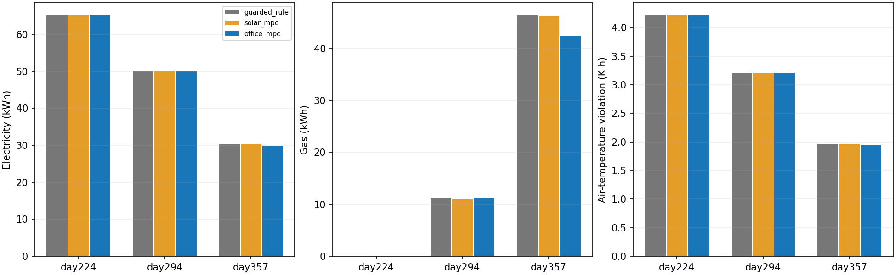
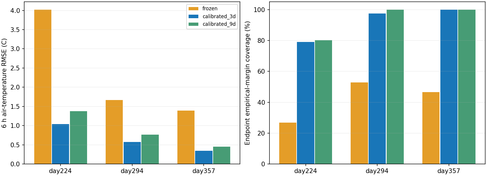

# 办公室少样本校准与独立时间留出

目标适配后，三个新日期的6小时温度和电量预测均优于原冻结迁移模型；**只有冬季day357的三种预报组同时满足节电、冷热越界不增和各能源不增**。相对规则节电1.274%、省燃气8.697%，暖季/过渡季未获实质收益。完成27个七天回合、全量审计与独立首6小时重复；没有根据新测试调参。

## 目标、信息条件与切分

在BOPTEST 0.9.0官方`bestest_air`、48 m²丹佛TMY办公室，对照原冻结迁移模型与目标校准模型。预测目标是**空气温度**，不是住宅操作温度或人的热感觉。供热为燃气空气侧末端，供冷为电驱冷却，电量包含制冷与风机；固定效率0.9、COP3与风机不向空气加热来自已知FMU源码，不是少样本估出的真实设备参数。

物理先验依据固定上游提交`9b1610b`的[末端源码](https://github.com/ibpsa/project1-boptest/blob/9b1610bf7a108826bb3d22c72bffd2d71d7bb0a9/testcases/bestest_air/models/BESTESTAir/BaseClasses/FanCoilUnit_T.mo)与[恒温器日程](https://github.com/ibpsa/project1-boptest/blob/9b1610bf7a108826bb3d22c72bffd2d71d7bb0a9/testcases/bestest_air/models/BESTESTAir/BaseClasses/Thermostat_T.mo)；本地上游checkout无改动，FMU与源码摘要见[来源清单](provenance.json)。

三个控制器覆盖同一个供暖设定值，18～23.25°C、每15分钟最多改变0.5K；冷却、风机和送风维持同一内置控制。校准MPC优化电＋燃气终端kWh，并分别限制两类预测能量不高于同模型规则参照。原冻结模型/参数/控制器完整保留，原热泵电耗映射不适配办公室；因此本轮是完整语义、末端、能源和模型适配的比较，**不是仅替换模型系数的纯消融**。原模型保留住宅操作温度训练语义，表中只评价它直接映射到办公室空气温度时的迁移近似，不将两种物理标签等同。

| 角色 | day | 轨迹长度与用途 |
| --- | --- | --- |
| 训练 | 14/84/140 | 每回合3天；分别取各回合前1/3天，嵌套3/9天、288/864条训练转移 |
| 选模 | 161 | 3天激励，仅选择预算和残差权重；另有三控制器各3天开发对照 |
| 裕量标定 | 171/182/196 | 各3天、共864条，仅标定逐步经验裕量 |
| 动作干预开发 | 42/168 | 各三档半天，供暖低/中/高20.5/22/23.25°C；4小时共同动作后8小时干预 |
| 全新测试 | 224/294/357 | 三预报×三控制器，各7天，全部在最终冻结后运行 |

训练、激励选模、标定和正式测试均计入6天内置预热＋1天22°C共同预序列，跨角色/回合不重叠；测试窗口[217,231)、[287,301)、[350,364)，避开旧day210/259/343办公室和旧住宅正式测试窗口。动作干预与部分开发日期有重叠，只作开发诊断，不是独立盲测。初始化后重置观测器，三个控制器共享前8步规则动作。旧办公室测试作为回归，没有用于本轮拟合或调参。

“3天少样本”仅指选中模型拟合预算。实际采集了9天训练、3天选模、9天标定，即21天激励轨迹；另外进行了9天控制开发和3天干预轨迹，失败/重复运行另存。未隐瞒选择、标定和验证成本，也没有把重采相同轨迹当新独立样本。配置与窗口见[协议](../../docs/experiments/office_calibration.md)和[切分清单](fit_split_manifest.json)。

## 开发选择与响应限制

空气/蓄热2R2C采用隐式15分钟能量平衡。供热/制冷直接进入空气节点；太阳项分配到两个节点，公开内部对流/辐射得热分别进入空气/蓄热。两种确定性初始化仅按训练损失选择；Ridge只用气象/日程残差。快速恒温器近似预测非负有界热/冷功率，风机为非负映射，分别计算电量和燃气。只用已发生温度/HVAC量更新观测状态，未来实际温度、冷热量与PI状态不会回填；未来冷却设定来自公开日程。

| 总训练预算 | 转移数 | day161选中残差权重 | 1/6/8小时温度RMSE均值 |
| --- | ---: | ---: | ---: |
| 3天 | 288 | 1 | 0.560430°C |
| 9天 | 864 | 1 | 0.599219°C |

按独立激励选模回合选择3天模型；新测试不重新选预算。9天更多数据在该开发指标上未获益，不据此泛称数据越少越好。早期全空气得热模型分数约0.866693°C，双初始化约0.866701°C，隐式平衡/投影末端约0.809844°C；这些开发版本还改变了输入/物理假设，不是严格控制变量消融。失败模型、代码和日志保留于本地`outputs/office-model-*`，摘要见[开发迭代](development_iterations.json)。选中模型太阳项落拟合下界，不能把有效R/C/得热系数解释为真实墙体参数。

标定采用3×61＝183个重叠预测起点，每步绝对温差95%经验分位数＋0.1K。选中模型6/8小时裕量为1.455895/1.681498K；原冻结6小时为0.943732K。新裕量更大，不能把覆盖改善全部归因于预测更准。原两段暖季标定没有供暖样本，补加day171后也只有20/864个有效供暖区间（热功率>0.01kW），仍不足以声称冷季95%覆盖。

**标定独立性的实际限制：** 开发时查看过day182/196的误差，用于诊断8/18时切换、空气/蓄热失配与供暖样本缺失，再修改了模型结构。三段均未参与最终参数拟合，角色时间隔离成立，但标定集不是完全未触碰的统计校准留出；冻结协议中“标定仅定裕量”描述终版计算用途，不能覆盖这段开发历史。本文的裕量只是开发经验裕量。真正未用于拟合、结构选择和控制调参的是冻结后的day224/294/357正式测试。

开发规则轨迹、完美API视图的6小时温度RMSE：原冻结2.089508°C、选中模型0.652288°C；各自端点裕量覆盖34.43%/91.80%。开发闭环电耗几乎等于规则，不能将离线误差下降当节能证据。完整[选模曲线](fit_selection.json)、[开发预测](development_prediction_metrics.csv)和[有效参数](effective_parameters.json)归档。

首次18°C冬季干预在第27步触发18°C中止线，失败轨迹保留；改20.5°C后六支完整重跑，不改变正式控制下限。两季首小时高档供暖的温度和燃气响应方向正确；但冬季6小时温差实测0.649°C、预测1.209°C，燃气差实测3.837kWh、预测5.210kWh，幅度仍有偏差。暖季制冷介入后6小时温差实测−0.022323°C、预测＋0.002515°C，原长时温度单调门失败，没有把它抹为浮点误差。

测试前有限开发门修订为：首小时温度/燃气方向；混合6/8小时燃气方向，以及温差预测误差在两倍已标定端点裕量内。原单调门仍单列失败；不改变模型/控制/裕量来过门。两倍裕量只是端点误差三角不等式的经验检查，**没有成对95%概率覆盖或全时域反事实准确性保证**。见[最终有限门](response_gate.json)、[原门失败](response_gate-monotonicity-failed.json)、[中止回合](aborted_low18_summary.json)。

## 全新时间留出结果

27支全部完成，共18,144条转移、544,347个原生30秒点。相对规则和原冻结MPC均为3/9组全门槛通过，全部来自同一个冬季日期的三种合成预报偏置，不能当三个独立季节成功样本。门槛维持1e-6容差：严格少电，冷热越界积分、时长和最大偏差不增加，且燃气/总终端能量不增加。

以下为完美API预报，三列依次规则 / 原冻结MPC / 校准MPC；[全部九组对照](results_table.md)与[逐组验收](acceptance.json)保留偏置和失败项。

| day | 电量kWh | 燃气kWh | 空气温度越界K·h |
| --- | ---: | ---: | ---: |
| 224 | 65.268155 / 65.268130 / 65.268141 | 0.000860 / 0.000860 / 0.000860 | 4.223524 / 4.223523 / 4.223529 |
| 294 | 50.097443 / 50.058107 / 50.097395 | 11.151611 / 10.953268 / 11.151742 | 3.211477 / 3.210445 / 3.211470 |
| 357 | 30.326296 / 30.309052 / 29.939873 | 46.456616 / 46.364818 / 42.416467 | 1.963811 / 1.963013 / 1.946624 |

冬季校准模型相对规则少电0.386423kWh（1.274218%）、少燃气4.040149kWh（8.696606%），总终端能量下降5.765048%；冷热分项、时长与最大偏差均不增。相对原冻结MPC节电1.180%～1.246%，同样通过全部门槛。三种预报下校准策略的实际轨迹相同，只能说明这些特定偏置没有改变本次决策，不能外推普遍天气鲁棒性或年度节能。

day224只少用约0.000014kWh电，过热积分增加约0.00000445K·h、最大过热增加约0.00000577K，未通过原门槛；这些微差无工程意义，也没有实质节能。day294只少电约0.000049kWh，却多用燃气约0.000131kWh，违反能源门槛。这两日期基本接近规则，不把浮点微差包装成改善或严重退化。

### 预测、裕量与回退

以下沿共同**规则轨迹、完美API预报、6小时条件预测**比较；误差单位°C，覆盖为各模型自身端点经验裕量。原模型没有办公室燃气预测头，燃气误差留空而非记零。其他步长、偏置和控制轨迹见[完整648行预测指标](prediction_metrics.csv)。

| day | 原冻结/3天/9天温度RMSE | 原冻结/3天/9天裕量覆盖 | 原冻结/3天电量RMSE kWh | 3天燃气RMSE kWh |
| --- | ---: | ---: | ---: | ---: |
| 224 | 4.023 / 1.038 / 1.377 | 26.75% / 78.98% / 80.25% | 3.531 / 0.456 | 0.000153 |
| 294 | 1.670 / 0.571 / 0.768 | 52.87% / 97.45% / 100% | 5.579 / 0.935 | 0.278 |
| 357 | 1.390 / 0.348 / 0.449 | 46.50% / 100% / 100% | 10.818 / 0.550 | 0.670 |

选中3天模型在这三日期也优于9天预算，但这只是特定切分结果，不据此否定更多数据。新温度预测改善和更宽裕量共同提高覆盖；夏季仅78.98%，经验95%标定没有转化为跨工况95%保证。电耗预测明显改善，燃气和干预能耗幅度仍有偏差；预测变好也没有自动带来所有季节的控制收益。

预测统计使用第16步之后、每4步一个起点的1/4/24/32步条件自由滚动，只将已记录的未来动作作为条件输入，不回填未来真实温度或HVAC量；完美API与传入偏置预报视图分列。这不等于在线已知未来实际动作。每个测试回合157个起点有大量重叠，三种偏置也不是三个独立气象年度。共同规则初始化只有前8步，第8～15步在线决策没有包含在这些起点统计中，控制结果和决策审计则覆盖全部步骤。

“fallback/mpc/reference_selected”原始规划日志保持不变，并另沿实际状态重建规则滞环和限速。本轮未发现标记MPC却与限速规则同动作的步骤；校准策略在三个完美预报日期的实际动作差异率为7.83%/31.48%/31.48%。动作不同不保证供热量或能耗改变，尤其在暖季供热已关闭时。

| day（完美预报） | 原冻结回退 | 校准回退 | 校准选择参照动作 | 校准实际动作与规则不同 |
| --- | ---: | ---: | ---: | ---: |
| 224 | 71.99% | 79.82% | 12.35% | 7.83% |
| 294 | 18.98% | 67.47% | 1.05% | 31.48% |
| 357 | 51.05% | 67.47% | 1.05% | 31.48% |

分母均为去掉共同前8步后的664步。全九组校准回退67.47%～80.57%，并未降低相对原模型的回退；两种策略其余模式不同，不能只按MPC模式占比排名。所有校准场景都有322/664步（48.49%）预测窗至少一处收紧温度带为空：办公温度带宽3K，小于部分步长的双侧裕量之和。这是经验约束不可行，不表示真实舒适区间物理上不可达。暖季还有支持范围拒绝，内置制冷的电耗也只能通过供暖动作间接影响。详见[模式与回退](decision_audit.json)、[独立动作/空约束诊断](constraint_diagnostics.csv)。

## 验证、限制与下一步

- 86项离线测试通过，编译检查通过；两预算、模型选择与切分独立重训逐字节一致，逐步裕量重建一致。
- 七支开发激励共2,016步、60,487原生点；全部开发/响应决策、单位、非供暖覆盖关闭、30秒积分与角色窗口检查通过。原六支重采轨迹逐值一致。标定参与过开发诊断和有限响应门的修订均已披露。
- 模型、源码、配置、协议及开发证据在2026-10-25 18:34:54北京时间冻结。全部18,144个正式决策重放，动作、限幅/限速、共同预序列/前8步、规则跨预报不变性、数据摘要检查通过；原住宅冻结源码、参数、模型与FMU摘要未改。
- 原生空气温度18.538～30.024°C，未越18～35°C中止带；舒适越界仍存在。含共同一天预序列的能源和温度KPI与API独立积分最大差8.882e-16，正式结果另排除该一天。
- 27支独立首6小时重复，共648步、19,467原生点，动作/原生数值/规划信息与正式前缀一致；**未独立重复完整七天**。
- 两张图已逐一查看，坐标、图例与布局正常。完整验证见[verification.json](verification.json)、[开发验证](development_development_verification.json)、[来源/环境](provenance.json)。完整模型、原始数据和失败轨迹保留本地`outputs/office-*`，不提交大型原始产物。

本轮只有单区、单个办公室FMU、一个TMY天气年度与三个新日期。内部得热日程视为已知，天气误差仅为合成±2K/±25%渐变，供暖/冷却热量从FMU能量读数按已知效率/COP换算，真实可观测性尚未验证。经验裕量不是概率安全证书，潜在状态不是已辨识真实墙体温度；没有真实数据校准、真实闭环或已验证Sim-to-Real。

下一步将本轮测试固定为回归：用新的冷/热季开发与未触碰标定集，重点识别末端动态和燃气/冷却能耗响应，检查按工况标定后的覆盖与可行性；再评估联合供暖/制冷执行器的公平对照。需要新的气象年度或未使用场景作为下一轮盲测，不能在本轮日期调完参数后再称泛化成功。当前证据支持继续改善物理/末端模型和约束，不支持仅靠增加网络规模或RL来承诺全年节能。
