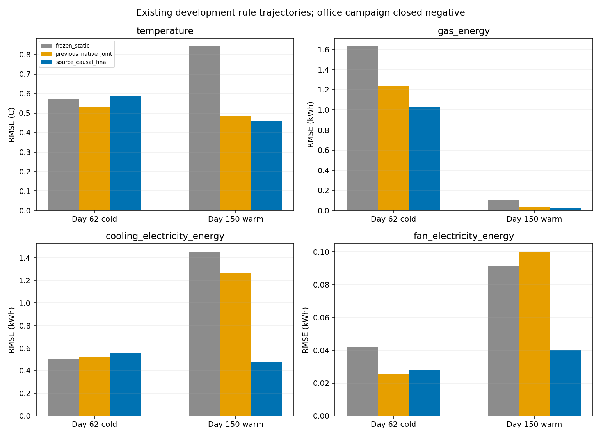

# 办公室迁移攻关收尾：负结果已封存

**本轮已按预设停止条件结束，状态`closed_negative`。** 唯一的源结构因果候选通过60/72项开发门、2/2项响应门，优化器收敛；仍有9项累计能源误差、1项温度误差和2项活动供暖覆盖不足。没有通过全门，因此**新校准0次、盲评0次**，保持规则控制，不再追加本轮办公室迁移开发。

停止规则在训练前写入[协议](../../docs/experiments/office_final_round.md)和[协议锁](protocol_lock.json)。[负结果封存文件](closure.json)绑定源码、模型权重、原门、数据和审计；实际调用prepare/fit/refit/evaluate均被拒绝，见[入口检查](closed_entrypoint_checks.json)。这不是迁移能力成功或允许部署的冻结。

## 实际执行范围

基线`39b169b`。诊断后只实现**一个**候选`source_causal_final`：取消功率代数反推PI，沿已经发生的温度/动作从零积分和公开初始风量恢复状态；固定源PI `k=0.1、Ti=120s、Ni=0.9`和双极点`−0.25948784/s`，1秒子步耦合2R2C、PI和二阶风量。未来记录动作和公开外生量仅作条件输入，预测窗不回填实测温度、功率或风量。

只拟合7个热网络参数、两种热功率比例、风机三次/一次项，共11参数；无网络、RL、残差头或候选追加。使用原12天训练day24/94/124/328，共34,560个原生区间；每8小时一个6小时训练起点，共32个起点。开发仍为day62/150规则/激励四支原轨迹和已有高低档响应，没有新FMU运行、开发数据扩充或旧测试调参。

求解器配置`max_nfev=60`，实际报告`nfev=13`、cost5.263894、ftol收敛；独立重训同预算得到完全相同模型。这里的SciPy `nfev`不包含数值Jacobian额外调用，未单独统计这些调用，不能把13写成全部实际计算次数。详见[预算说明](budget_notes.json)。

与上一轮14参数、128个训练起点的原生模型相比，本轮同时改变了结构约束、参数自由度和起点密度；可以比较最终方案，不能把所有变化唯一归因于某一个修复。数据全部是既有开发角色，不能把本轮成绩称为新留出泛化。

## 门槛未变，失败项保留

完整沿用`configs/native_terminal.json`，未改变温度/能源容差、归一、季节标签或活动样本门。原函数内部候选名`native_joint`仅作兼容适配，报告改名为本候选；单元测试核对了适配不改变数值和判定。

| 检查 | 通过/总数 | 结论 |
| --- | ---: | --- |
| 1/6小时温度 | 7/8 | 冷季激励6小时未过相对旧模型回归门 |
| 1/6小时三能源累计量 | 15/24 | 9项未过，主要是长时制冷/风机 |
| 5/15分钟三类端点功率 | 24/24 | 短时功率门通过 |
| 各季节/能源活动样本 | 10/12 | 暖季供暖起点仅2/0，低于10 |
| 开发起点数量 | 4/4 | 每轨迹63个重叠起点 |
| 两档动作响应 | 2/2 | 方向、6小时燃气差幅度均通过 |
| 优化器收敛 | 1/1 | 预算内收敛 |

前五项合计60/72；整体仍未通过。次数不是独立成功概率，起点重叠，也没有统计显著性结论。完整[72项门](gates.csv)、[12项失败](failed_gates.csv)、[能力矩阵](capability_matrix.csv)、[响应和判定](assessment.json)均保留。

训练前预检查已经记录暖季供暖活动不足，本轮没有通过换模型或扩数据绕过这一门。最终也存在实际预测精度失败，不能把停止原因全部归为样本不足。

## 改善与剩余误差

同一规则轨迹，每日期63个起点，6小时RMSE如下；温度°C，能源kWh。完整两类轨迹、多时长和偏差见[指标](metrics.csv)、[前后对照](comparison_metrics.csv)与[结果表](results_table.md)。

| 日期 | 模型 | 温度 | 燃气 | 制冷电 | 风机电 |
| --- | --- | ---: | ---: | ---: | ---: |
| 冷季62 | 原冻结静态 | 0.568742 | 1.627917 | 0.507448 | 0.041901 |
| 冷季62 | 上轮原生联合 | 0.528901 | 1.240074 | 0.522609 | 0.025738 |
| 冷季62 | 本轮源结构因果 | 0.585066 | 1.024036 | 0.555174 | 0.027927 |
| 暖季150 | 原冻结静态 | 0.840621 | 0.107045 | 1.450206 | 0.091503 |
| 暖季150 | 上轮原生联合 | 0.484290 | 0.036353 | 1.265100 | 0.099868 |
| 暖季150 | 本轮源结构因果 | 0.460380 | 0.022197 | 0.475879 | 0.039899 |

暖季制冷/风机误差明显下降，冷季温度和制冷/风机相对上轮反而恶化，不能只报告暖季改善。暖季规则制冷6小时门为0.311670kWh，实际0.475879；风机门0.011653，实际0.039899，改善后仍不足。

冷季激励温度6小时RMSE0.710564°C，原静态0.624060、回归上限0.674060，所以尽管低于1°C绝对门仍判失败。其余长时能源失败与暖季供暖覆盖不足逐项列入失败表，没有放宽某一侧条件。

两档响应有所改善：冷季实测6小时燃气差3.179894、本轮3.640069kWh，误差0.460176，低于原幅度门1.589947；暖季实测1.468161、本轮1.613419，误差0.145258，低于0.734081。上轮冷季响应未过，本轮两支通过；这是有限开发干预结果，不是任意候选动作准确或控制节能证书。



## 因果与完整性验证

- **122项测试通过**，新增10项验证源双极点阶跃、PI饱和记忆、1秒热量单位、未来标签/oracle字段隔离、动作响应、30秒计量、原门适配和封存阻断。
- 独立重训的权重、拟合摘要逐字节相同。本轮模型SHA `ceb5276fa1e42369a85e81d7cfa844bbbbff652d05cd2bc02f5b516cfdd30d65`；原模型SHA仍`71de604f98e68f599f55f5b479866707857660b26eb83f76989080ded476517d`。
- 8个训练/开发回合的未来温度、功率、风量和伪造内部oracle字段扰动不改变当前预测；非负功率、原生梯形计量和能源独立重算通过。内部积分/滤波真值只在拟合后核验观察器，不进入拟合或预测。
- 门、指标独立重建逐字节相同；原静态32行参照指标与上轮精确一致。已知活动起点2/0与预检查一致，所有旧冻结链有效。
- `seal`生成负结果封存文件后，四个开发入口实际调用均被拒绝，封存前后摘要一致；`check`核验权重、协议、审计、数据门和结果摘要通过。没有新校准/盲评目录。

封存的原始证据在`outputs/office-final-round`；Git只保存紧凑报告、参数和摘要，不包含模型二进制、原始大轨迹或凭据。[来源记录](provenance.json)分开记录原始工件与LF归档摘要。

## 办公室适用边界和结束决定

明确边界见[BOUNDARY.md](BOUNDARY.md)：固定48m² bestest_air、空气温度、已知PI/风量结构、燃气供暖/电制冷/风机和单一供暖设定值。支持这一条件下的可复现离线建模研究；没有取得跨季节替代规则的节能控制资格，没有真实办公室或Sim-to-Real结论。部分开发项通过不单独构成部署许可，当前规则自身也有过热记录。

**办公室迁移这一轮攻关结束。** 不进入新的校准和盲评，不继续追加模型、数据或门槛修订；规则保持主控制基线。项目仍有人员需求接入、系统学习控制对照和作品交付等未完成事项，但它们不在本轮自动执行。

复现需要原训练/开发数据与冻结链。封存后的默认开发入口拒绝继续执行；当前状态可只读核验：

```powershell
.venv-cpu/Scripts/python.exe -m thermal_comfort.office_final_round check
.venv-cpu/Scripts/python.exe scripts/report_office_final_round.py
.venv-cpu/Scripts/python.exe -m unittest discover -s tests -v
```

训练前的执行顺序为prepare→fit/refit→evaluate→独立审计→seal，全部证据已归档。若未来重新提出研究，应另立问题、数据角色和协议，保持本次封存及旧测试完整，不能把追加调参继续称作这一次盲评。
