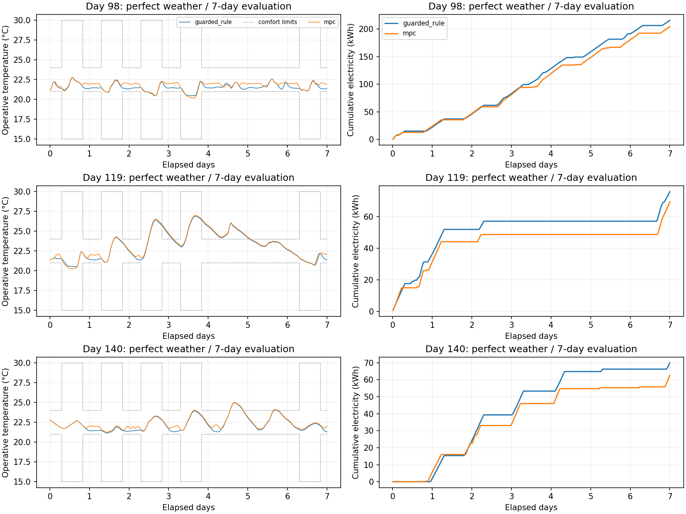
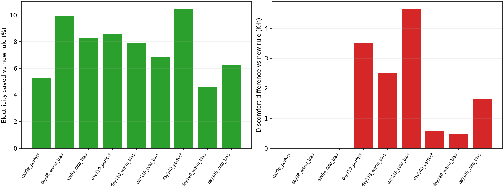

# 舒适恢复、空载耗电与天气误差对照

本阶段完成实现与固定场景测试，但**未达到跨工况“不增加温度越界的节电”目标**。MPC相对新恢复规则在9组条件中均节电；只有day98的3组同时保持零温度越界，day119与新增day140的6组均增加过热。不能只按9组平均耗电宣布成功。

这里的指标是官方操作温度区间的越界，不是人员主观热感觉或冷热偏好；中止带与舒适区间分别核验。

## 改动与实验范围

仍使用BOPTEST 0.9.0同一192 m²供暖热区、固定FMU、15分钟控制与30秒原生积分。提前4小时按占用日程恢复、0.3/0.6 K滞环和20.5°C非占用设定下限由新规则与MPC组合共享；动作仍限18～23.25°C、0.5 K/步。MPC预测2小时，加入给定天气预报的偏暖/偏冷包络，以最坏预测电费与动作变化惩罚选计划。模型范围、经验裕量、初始化、恢复、过热及非法预测均保留回退。

三种天气模式为官方完美天气、预报偏暖2 K且太阳辐照高估25%、预报偏冷2 K且辐照低估25%；偏差从当前测量的零线性增至2小时全幅。只改控制器预报视图，FMU天气、当前测量、状态观测更新、真实日程与KPI使用原值。规则可获得相同预报信息，但只利用日程，天气扰动不会影响其动作。

本轮参数在day84验证后固定，看到测试失败后未调参。day98/119沿用已看过旧实验结果的回归日期；day140是新增日期，仍来自同一FMU与年度。没有独立楼宇、真实气象预报、真实闭环或统计显著性证据。协议和命令见 [实验协议](../../docs/experiments/recovery_mpc.md)。

## 训练、覆盖与预测

在旧三组训练回合之外补采day63训练、day84验证，各7天，共1,344条转移和40,322个原生点。训练评测截至day70，验证预热从day70开始；验证评测截至day91，测试预热从day91开始，跨角色半开时间窗不重叠。同角色新增预热与旧评测有重叠，不能算作独立随机样本。所有参数仅用2,688条训练转移拟合；原验证前3天选残差权重，原验证后段及新增验证用于234个起点的裕量校准。

高设定值与停机段把训练起点温度从21.07～24.69°C扩至20.60～26.00°C。原day119测试仅按室内温度判断的支持比例从75.16%升至91.93%；但**室外最高温仍为11°C**，太阳辐照上界仅从480增至492 W/m²，没有解决炎热天气覆盖。该测试2小时完整输入处于支持范围内的比例仍为34.16%；室内范围扩大不等于完整工况覆盖改善。

同一组161个预测起点（15分钟至4小时比较、步距1小时）上的新旧模型结果如下；起点与上一阶段为24小时预测统一截断的表不同。

| 原激励测试 | 旧/新2小时温度RMSE °C | 旧/新2小时累计耗电RMSE kWh |
| --- | ---: | ---: |
| day98 | 0.4363 / 0.4098 | 0.7490 / 0.6498 |
| day119 | 0.5014 / 0.4596 | 0.6826 / 0.5405 |

残差权重仍选1；2小时经验裕量约0.727 K，两个测试的覆盖率90.06%/86.96%，仍低于95%，不是概率或安全保证。天气误差下2小时温度RMSE：day98完美/偏暖/偏冷为0.410/0.613/0.230°C，day119为0.460/0.706/0.255°C；某方向误差偶然抵消模型偏差不构成可靠性改善。

## 空载耗电

旧模型无论是否供热都添加约0.30 kW固定运行截距。新模型用907个训练空载区间估计约0.000618 kW待机项，运行截距乘以连续门控 `min(Q/0.5,1)`，其余供热和室外温度项保持非负。零热量预测约0.000155 kWh/15分钟；不是将所有零供热区间强行置零。

以下隔离耗电映射误差，输入真实区间热量，**不包含执行器预测误差，也不是闭环节电量**。

| 测试空载区间 | 样本数 | 旧/新偏差 kWh/15分钟 | 旧/新RMSE kWh/15分钟 |
| --- | ---: | ---: | ---: |
| day98，Q<0.05 kW | 295 | 0.074833 / 0.000524 | 0.074835 / 0.002487 |
| day119，Q<0.05 kW | 510 | 0.074888 / 0.000322 | 0.074889 / 0.001767 |

分段耗电映射显著减小此偏差，但区间供热与耗电受设备启停、余热影响，并非严格一一对应关系。详细全工况误差见 [功率映射指标](model_power_metrics.csv)。

## 正式闭环结果

3个日期 × 3种天气模式 × 2个控制器，各7天，共 **12,096条转移、362,898个原生点**。主比较基线是本轮新恢复规则；所有天气模式下该规则的真实轨迹相同。每个日期的规则耗电/越界分别为215.688 kWh/0 K·h、75.969 kWh/35.008 K·h、69.839 kWh/4.919 K·h。

| 日期 | 预报条件 | MPC耗电 kWh | 相对新规则节电 | 新规则/MPC越界 K·h | 同时达标 |
| --- | --- | ---: | ---: | ---: | --- |
| 98 | 完美 | 204.244 | 5.31% | 0 / 0 | 是 |
| 98 | 偏暖 | 194.210 | 9.96% | 0 / 0 | 是 |
| 98 | 偏冷 | 197.788 | 8.30% | 0 / 0 | 是 |
| 119 | 完美 | 69.456 | 8.57% | 35.008 / 38.516 | 否 |
| 119 | 偏暖 | 69.943 | 7.93% | 35.008 / 37.505 | 否 |
| 119 | 偏冷 | 70.790 | 6.82% | 35.008 / 39.663 | 否 |
| 140 | 完美 | 62.523 | 10.48% | 4.919 / 5.481 | 否 |
| 140 | 偏暖 | 66.614 | 4.62% | 4.919 / 5.406 | 否 |
| 140 | 偏冷 | 65.459 | 6.27% | 4.919 / 6.576 | 否 |

全部回合的过冷积分均为0。day119/140增加的都是过热，越界时长及最大超温也增加，不只是积分小幅波动。day119完美天气新规则/MPC越界时长为35.792/36.783小时，最大超温2.383/2.486 K；day140为9.658/11.017小时、0.986/1.031 K。按原生点与每日日程独立积分，完整分项见 [比较表](comparison.csv)、[逐日表](daily_comparison.csv) 与 [机器可读验收](acceptance.json)。

完美天气MPC接管比例为89.29%/32.29%/45.98%。day119仍有265/672步因支持范围回退、161步过热减热、19步恢复；day140有293步支持范围回退。收益来自MPC、模型变化与共享恢复规则的组合，未进行全部因素的闭环消融，不能单独归因于残差模型。

## 舒适恢复相对旧版的代价

day98旧规则/旧MPC的越界7.915/7.966 K·h，本轮两者均为0，但耗电从193.314/180.002升至215.688/204.244 kWh。day119本轮完美天气两者越界35.008/38.516 K·h，较旧版39.412/39.978减少，但耗电从61.954/60.687升至75.969/69.456 kWh。

所以，**“本轮MPC比本轮规则节电”不等于“比旧MPC更省电”**。恢复舒适确有改善，同时付出了更多供热电量。供暖热区无法主动制冷，较暖回合的蓄热/太阳增益与回退行为仍导致过热；上述对照只确认实际轨迹变化，没有证明每个机制的独立因果贡献。

## 验证证据

- **59项离线测试通过**（原51＋新增8），覆盖当前测量/日程不受预报误差污染、偏差幅度、空载门控与非负性、提前恢复、滞环、浅回落、过热优先减热、鲁棒候选与OOD/不可行回退。
- 独立进程重新拟合的模型、选择、指标和切分文件逐字节一致；另外只传入训练回合重拟合RC与执行器，参数完全一致。训练待机功率、非负运行回归、残差权重和验证裕量分别重建通过。
- 六支独立FMU高低档干预方向门槛通过并绑定当前模型/配置摘要；验证与正式运行前8步、同一场景初始化和真实外生数据一致。正式12,096步以及验证、采集、干预策略均重放一致，排除墙钟时间，数值容差1e-10。
- 所有46支回合的摘要、长度、原生间隔、转移对齐和KPI重算通过，四类KPI与API最大绝对差约7.82e-14。正式回合原生温度20.062～27.046°C，中止带未违反；这不等于舒适约束通过。
- 18支各首6小时、共432步的FMU重复与正式轨迹前缀数值精确一致；没有重复整个7天。正式运行开始时的模型、代码及配置摘要核查通过，9组对照没有缺项；跨天气条件的规则原生/转移/真实外生轨迹精确一致。
- 旧阶段模型、干预和控制的完整验证脚本再次通过；两张新图已查看。CI执行离线测试，FMU集成核验在本地完成。

机器可读证据见 [verification.json](verification.json)、[决策审计](decision_audit.csv)、[模型来源与切分](model_split_manifest.json)、[裕量与支持覆盖](model_coverage.csv)、[天气误差预测指标](model_weather_prediction_metrics.csv) 和 [工件摘要](provenance.json)。

## 限制与后续

室外暖工况覆盖仍不足，规则与MPC在这些时段均不可靠；下一轮应先固定新的暖天气训练/验证/盲测时序，再评估太阳增益、蓄热状态与提前停热，不能继续用day119/140调参后把它们称为盲测。应保留最小供暖基线，区分无法制冷的物理极限与可避免的供暖过热。

天气偏差只有一个幅度和两个固定方向，不能代表真实预报误差分布。支持检查针对中心预报，包络边缘可能外推；相对给定预报的乘法辐照包络也不保证覆盖相对真实天气定义的25%误差（低估25%时反向恢复需要33.3%）。经验裕量、包络与短时可行性均未形成实际安全保证。

阶段日志见 [开发日志](../../docs/development/2026-10-22-milestone-01.md)。完整轨迹与权重保存在本地`outputs/recovery-*`，Git只提交紧凑证据；原基线、旧报告和历史代码保留。尚未接入人员需求模型、强化学习、真实楼宇闭环或Sim-to-Real验证。
