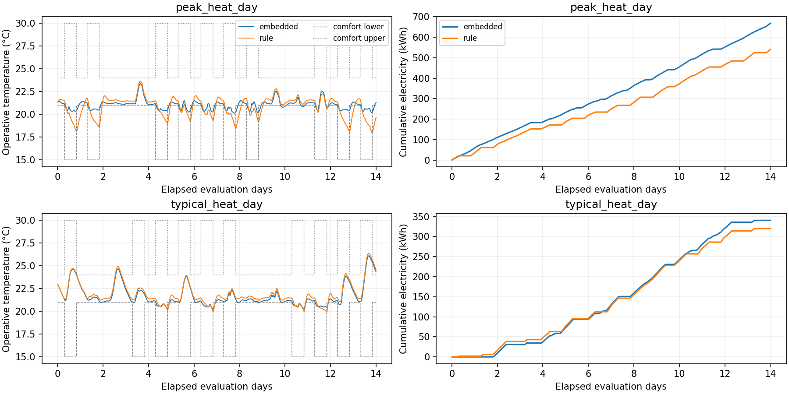

# 单热区仿真与规则控制结果

日期：2026-10-22，北京时间。BOPTEST 0.9.0，`bestest_hydronic_heat_pump`，192 m²。每回合内置控制预热 7 天、正式评测 14 天，控制周期 15 分钟。完整协议与复现命令见 [实验说明](../../docs/experiments/simulation.md)。

**本阶段已跑通可复现的仿真与数据采集。简单规则减少耗电，但增加温度越界，未实现同时改善两项指标。** 没有进行规则参数搜索，也没有以结果反向调整本次基线。

## 正式结果

| 供暖场景 | 控制器 | 总耗电 kWh | 耗电 kWh/m² | 温度越界 K·h/zone | 成本 EUR/m² |
| --- | --- | ---: | ---: | ---: | ---: |
| peak | 内置 | 667.732 | 3.477770 | 8.381693 | 0.881615 |
| peak | 规则 | 539.709 | 2.810987 | 50.964248 | 0.712586 |
| typical | 内置 | 340.414 | 1.772991 | 9.445893 | 0.449454 |
| typical | 规则 | 319.857 | 1.665922 | 12.822163 | 0.422311 |

规则在 peak/typical 场景分别少用电 **19.17% / 6.04%**，温度越界分别增加 **42.58 / 3.38 K·h**。这些百分比只描述相同场景下的耗电差异；温度约束表现同时变差，不能据此宣称控制策略整体优于内置控制。两者分别独立初始化，评测窗口和电价相同。

rule 只覆盖热泵温度设定：有人时舒适下界 +0.5 K，无人时 +3 K，保留底层 PI；embedded 不启用覆盖。没有读取未来外生信息来决策。图中低温回落和恢复过程可帮助下一阶段研究地板供暖惯性，但当前结果未隔离每条规则的因果影响。

耗电用原生功率积分并按精确 SI 单位换算；官方 KPI 采用稍有舍入的转换系数，兼容值单独保存在 `summary.json`。温度越界是操作温度相对官方动态上下界的偏差积分，包含无人时段，不是主观舒适评分。

## 验证证据

- 4 回合各 1,344 步，共 **5,376** 条转移；各 40,321 个原生点，共 **161,284** 点。最大采样间隔 30 s，时间边界和动作应用均通过核查。
- 保存后重新读取并校验 SHA-256，重新生成转移表；每步能耗之和等于总能耗。独立重算能耗、温度越界、成本和排放，四回合与官方 API 的最大绝对差为 **7.11e-14**，低于设定容差。
- 停止并重建全部容器后，独立重跑四回合首日，共 384 步、11,524 个原生点。原生轨迹与控制转移的所有数值均与正式运行首日**精确一致**（忽略 CSV 因全零短列而推断出的整数/浮点类型差异，不使用数值误差容差）。这验证首日重启复现，未声称完整 14 天重复运行已验证。
- **23 项离线测试通过**，包括历史预测基线 13 项、新增仿真协议 10 项；CI 同样运行这些测试。真实 FMU 集成验证在本地 Docker/WSL 完成。
- 部署 `down → up` 以及再次 `up` 均通过；服务保留在本机 `http://127.0.0.1:8080`，采集结束后释放所有本次 testid。

## 工件

| 文件 | 内容 |
| --- | --- |
| [metrics.csv](metrics.csv) | 四回合完整精度指标 |
| [summary.json](summary.json) | 每回合配置、指标、时间范围和全部原始工件哈希 |
| [manifest.json](manifest.json) / [provenance.json](provenance.json) | Python、服务、代码/配置哈希及固定 FMU 来源 |
| [verification.json](verification.json) | 保存后重算和首日重复验证 |
| [first_day_transitions.csv](first_day_transitions.csv) | 四回合首日共 384 条转移样例；正式运行的子集，不另作独立测试集 |
| [runtime_images_after_restart.json](runtime_images_after_restart.json) | 实际服务重启后镜像 ID 快照；主仿真镜像固定于 Compose |

完整原生轨迹、外生变量、原始 JSONL、API 字段和摘要在本地 `outputs/simulation/`，约 24.2 MB，未提交 Git；首日重复工件在 `outputs/simulation-repeat/`。Git 里的紧凑报告与固定配置足够审查，并可重新生成完整数据。

## 下一步与限制

本次只验证两个供暖窗口和一个住宅热区。规则动作覆盖有限，轨迹不能作为世界模型具有广泛动作泛化能力的证据。下一子阶段先设计独立安全激励与回合切分，再做持久性/线性动态模型和多步预测误差验证，随后接入受约束 MPC。人员热感觉/偏好预测模型仍不直接充当控制约束。本阶段没有强化学习或真实楼宇闭环 Sim-to-Real 结论。
