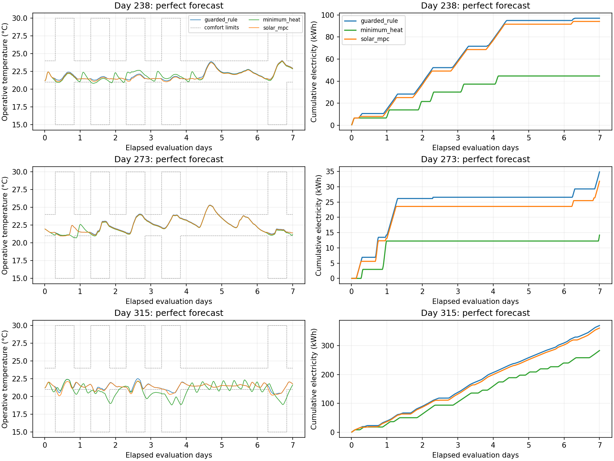
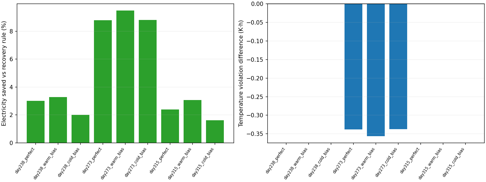

# 暖天气、蓄热状态与提前停热实验

本轮固定的新时间留出测试中，**9组日期/天气条件均实现相对恢复规则节电且温度越界不增加，节电1.62%～9.49%**；过冷/过热分项、越界时长与最大偏差也均未增加。暖天气数据扩充有效，但新的复杂太阳/蓄热结构没有胜出，控制采用重新拟合的简单模型。

指标仍是官方操作温度区间越界，不能解释为人员主观热感觉或偏好改善。达标范围限于本轮固定仿真测试集；验证中的热浪仍在零耗电下严重过热，不代表全工况或真实楼宇安全。

## 数据与切分

新增day147训练、day168/189验证，各7天，共2,016条转移、60,483个原生点。训练还使用旧day14/35/56/63及旧day119激励，总计4,032条训练转移。**旧day119在本轮明确退休并改为训练，不再作为测试证据**；原实验与角色文件没有改写。

训练评测最晚结束day154，验证预热从day161开始；验证评测最晚结束day196，新测试预热最早从day231开始。新测试固定day238/273/315，各7天、各7天预热，测试之间也不重叠。同角色旧day56/63预热相关，不能当作独立随机样本。

只用固定天气文件的外生变量预先核查季节覆盖，未用新控制结果选日期。本轮训练室外范围扩至**−3.10～26.96°C**、辐照最高881.13 W/m²，较前轮11°C/492 W/m²明显扩大；室内训练起点20.60～27.41°C。验证最高室外31.63°C，仍包含训练支持之外的炎热天气；不能声称补齐了所有工况。

暖季仿真中止带在采集前固定为18～35°C，以保留无法通过供暖消除的过热。**官方舒适日程保持原样**，超28°C原生点单独计数。day189激励的原生最高温30.331°C、4,336个点高于28°C，不能因未触发新的中止上限就称为安全。

## 模型消融与择优

所有候选仅用相同训练数据拟合，在day168前3天的同一61个起点、1/2/6/8小时自由滚动温度RMSE均值选模型和0/0.5/1残差权重；预测终点不越出选择时段。之后的222个验证起点用于经验裕量。模型开发会查看验证结果，不作独立校准或概率保证。

| 同数据候选 | 选模温度误差 °C | 权重 | 是否采用 |
| --- | ---: | ---: | --- |
| 原2R2C＋递归状态观测 | 0.200878 | 1 | 是 |
| 同RC＋过去4小时窗口估计 | 0.208264 | 1 | 否 |
| 即时/存储太阳增益分拆＋窗口估计 | 0.206007 | 1 | 否 |

窗口估计只使用当前和过去的操作温度及真实区间供热，拟合潜在热容量初态后推到当前；不是读取真实楼板温度。分拆模型将太阳增益分别输入热区和潜在热容量，保持物理参数正值、稳定网络与非负耗电。但存储太阳增益系数约0.010001 m²，接近预设下界0.01 m²，数据没有支持这一分拆的独立优势。**复杂结构没有胜出，因此控制使用简单模型**，不为了展示新算法而强行替换。

同一157个验证起点、相同真实动作与天气输入的2/6小时温度误差：

| 验证日期 | 前轮模型2/6小时RMSE °C | 同数据简单模型2/6小时RMSE °C | 分拆＋窗口模型2/6小时RMSE °C |
| --- | ---: | ---: | ---: |
| day168 | 0.669 / 1.390 | 0.231 / 0.394 | 0.260 / 0.402 |
| day189 | 0.656 / 1.375 | 0.199 / 0.359 | 0.219 / 0.359 |

主要改善来自训练覆盖扩大，不能把前轮与本轮的差异全部归因于结构变化。1/2/6/8小时经验裕量约0.435/0.600/0.944/1.097 K；供热执行器与电功率幅度仍有偏差。

各候选参数在`model_parameters.csv`分别列出；`model_selection.json`中的`fit_cost/fit_nfev`对应分拆太阳候选的优化，采用哪个结构以`selected_model`为准。最终源码的独立重训清单另保留为`refit_manifest.json`。

六支FMU高低档干预含4小时共同序列和8小时限速动作。day168在6小时的实际/预测高低档温差0.165/0.487°C、耗电差3.408/6.656 kWh；day189几乎无响应且均零电耗。方向门槛通过，**幅度并不准确，也不是任意动作的反事实准确性证书**。

## 提前停热与最小供暖

三个控制器共享初始化、前8步、18～23.25°C动作与0.5 K/步限速。恢复规则沿用4小时日程前瞻；最小供暖仅在当前温度接近下界时加热，其余取最低设定值。它是低供暖参照，未匹配相同舒适水平，不是能耗/过热的数学下界。

新MPC使用6小时计划与8小时最低供暖投影，满足经验防冷裕量且即将过热时提前停热。候选预测温度、潜在蓄热及首动作不得高于同模型模拟的规则参照，以减少为了前瞻而额外蓄热。这个过滤只在模型中成立，不构成真实闭环单调性或安全保证；不可行、支持范围外或非法预测仍回退。

第一版验证没有规则参照过滤：day168耗电6.915 kWh、越界5.447 K·h，少用电但比规则4.914 K·h越界更多。保留该失败后，只在验证阶段加过滤；第二版为6.579 kWh、4.711 K·h，相对规则8.773 kWh节电25.01%，且各舒适分项均未增加。此后冻结模型和控制，再运行新测试。

day189三种控制器均零耗电、约292.696 K·h越界。对该初始化和天气，没有新增供暖也会过热；这不是所有初态与控制策略的全局下界。规则与MPC仍有约0.000893 K·h微小差异，可能受FMU数值事件影响，但未据此放宽1e-6验收容差，也不声称该回合通过节电门槛。

## 新测试上的预测误差

以下只比较完美天气的规则轨迹，四种模型均使用相同157个起点与真实未来动作，自由滚动6小时，不能回填中间真实状态。

| 日期 | 旧/新选中模型6小时温度RMSE °C | 旧/新输入支持盒覆盖 | 新6小时裕量覆盖 |
| --- | ---: | ---: | ---: |
| 238 | 0.707 / 0.179 | 5.73% / 100% | 100% |
| 273 | 0.246 / 0.285 | 1.27% / 100% | 98.09% |
| 315 | 0.466 / 0.512 | 82.17% / 82.17% | 91.72% |

支持盒仅检查当前操作温度与未来室外温度/辐照是否落在训练各维范围＋既定容差，不是联合密度或动作反事实覆盖证明。暖日期输入范围的缺口显著缩小，但**预测没有在所有日期变好**，极冷日期裕量也未保持95%。复杂候选在部分测试指标上略优，未据此重新选模型或调整参数。全部模型、控制器与天气模式见[预测指标](prediction_metrics.csv)。

## 新时间留出闭环结果

3个新日期 × 3种天气 × 3个控制器，各7天，共**18,144条转移、544,347个原生点**。下表主比较为相同初始化和动作限制下的恢复规则与提前停热MPC，不与上一轮不同日期直接比节电幅度。

| 日期 | 预报 | 规则/MPC耗电 kWh | 节电 | 规则/MPC越界 K·h |
| --- | --- | ---: | ---: | ---: |
| 238 | 完美 | 96.967 / 94.056 | 3.00% | 0 / 0 |
| 238 | 偏暖 | 96.967 / 93.789 | 3.28% | 0 / 0 |
| 238 | 偏冷 | 96.967 / 95.030 | 2.00% | 0 / 0 |
| 273 | 完美 | 34.899 / 31.830 | 8.79% | 7.289 / 6.951 |
| 273 | 偏暖 | 34.899 / 31.586 | 9.49% | 7.289 / 6.933 |
| 273 | 偏冷 | 34.899 / 31.825 | 8.81% | 7.289 / 6.952 |
| 315 | 完美 | 369.467 / 360.663 | 2.38% | 0 / 0 |
| 315 | 偏暖 | 369.467 / 358.147 | 3.06% | 0 / 0 |
| 315 | 偏冷 | 369.467 / 363.498 | 1.62% | 0 / 0 |

九组均满足预先固定的“严格少耗电＋总越界不增”门槛，也满足更严格的各舒适分项不增。MPC测试回合没有过冷；day273仍有过热，因此“未增加越界”不是“没有越界”。完美天气下day273越界时长从9.250降至9.042小时，最大超温从1.331降至1.294 K。完整每日结果、分项与机器门槛见[对照表](comparison.csv)、[逐日结果](daily_comparison.csv)、[验收](acceptance.json)。9/9是有限条件的计数，不是随机成功概率，也未做统计显著性检验。

完美天气下，三个日期分别有300/319/146步优化计划、36/67/0步提前停热；day315有140步因模型支持范围回退、378步无裕量可行计划。结果来自新数据、较长时域、规则参照过滤和回退的组合，**不能全部归因于学习模型**；未做完整闭环因素消融。

## 最小供暖的取舍

| 完美天气日期 | 最小供暖耗电 kWh | 过冷 K·h | 过热 K·h | 越界时长 h | 最大过冷 K |
| --- | ---: | ---: | ---: | ---: | ---: |
| 238 | 44.705 | 0.112 | 0 | 2.133 | 0.105 |
| 273 | 14.190 | 0.521 | 6.719 | 11.083 | 0.298 |
| 315 | 282.927 | 27.324 | 0 | 44.417 | 2.126 |

最小供暖更省电，但三日期均新增过冷，day315尤其明显。day273总越界看似略低于规则，却将一部分过热换成了过冷，且越界时长更长；只看电量或总越界会遗漏这一取舍。MPC相对该参照用了更多电，获得更好的温度约束表现，不能宣称比最小供暖更省电。

验证day189的零耗电过热则表明：该固定初始化下，优化供暖电量本身不足以消除热浪不适；进一步降低此类过热应另行评估遮阳、通风或制冷，本轮没有引入这些能力。

## 验证与复现

- **69项离线测试通过**（原59＋新增10）：太阳/热网络正性与稳定性、过去窗口潜在状态估计、在线/离线一致、未来真实状态/供热无泄漏、提前停热防冷、规则蓄热参照过滤、最小供暖、动作限速、共同初始化和跨角色/测试预热隔离。
- 最终源码独立重训与正式模型、候选、选择、指标、切分逐字节一致；仅传训练回合的RC/执行器拟合与待机/运行功率重建通过。验证前段选模与222个后段裕量起点重建通过。
- 75个回合原始摘要、原生间隔、转移对齐及四类KPI核验通过，API最大绝对差约2.27e-13。正式18,144步决策，以及采集、干预、两版验证策略全部重放一致，数值容差1e-10、排除墙钟耗时。
- 初版源码由[补丁](validation_v1_source.patch)恢复，与初版运行清单SHA-256精确一致，初版4,032步也按当时策略重放通过；没有把失败改写成第二版行为。
- 27组各首6小时、共648步FMU重复与7天正式轨迹前缀数值精确一致，未重复整个7天。三控制器初始化/前8步及真实天气一致，规则与最小供暖对天气扰动的真实轨迹精确不变。
- 正式回合原生温度18.822～25.331°C，无点超过28°C；较高的35°C中止上限主要用于保留热浪验证，不改变正式舒适积分。正式各控制器策略调用p95最大约40.9 ms，未计通信和FMU时间。
- 两张图已查看；CSV、JSON副本和代码的摘要随[provenance.json](provenance.json)归档，JSON副本使用UTF-8/LF以匹配Git存储。CI运行离线测试，真实FMU集成核验在本地完成。

详细审计见[verification.json](verification.json)、[决策记录](decision_audit.csv)、[时间切分](model_split_manifest.json)、[选模](model_selection.json)与[动作响应](response_response_metrics.csv)。

## 天气误差与证据边界

完美、偏暖2 K/辐照高估25%、偏冷2 K/辐照低估25%三个模式只扰动策略收到的预报视图，当前测量、状态更新、真实天气与KPI保持原值。本轮偏差随6小时计划线性达到全幅，与前轮2小时全幅不同。MPC按给定预报规划，属于合成误差压力测试，没有概率天气预报或鲁棒安全保证。

新测试仍只来自同一楼宇模型和同一年度；极冷day315超出训练室外下界，其结果包含大量规则回退，不能解释为模型外推准确。状态更新目前依赖FMU可得的区间供热，在真实楼宇需要热量计或估计器，本轮没有解决这一条件。没有人员需求预测器、强化学习、跨建筑或真实闭环Sim-to-Real证据。

运行命令与预先固定的验收条件见[实验协议](../../docs/experiments/solar_mpc.md)，阶段过程见[开发日志](../../docs/development/2026-10-22-milestone-01.md)。完整数据、模型与失败工件保存在本地`outputs/solar-*`，原实验不覆盖。
