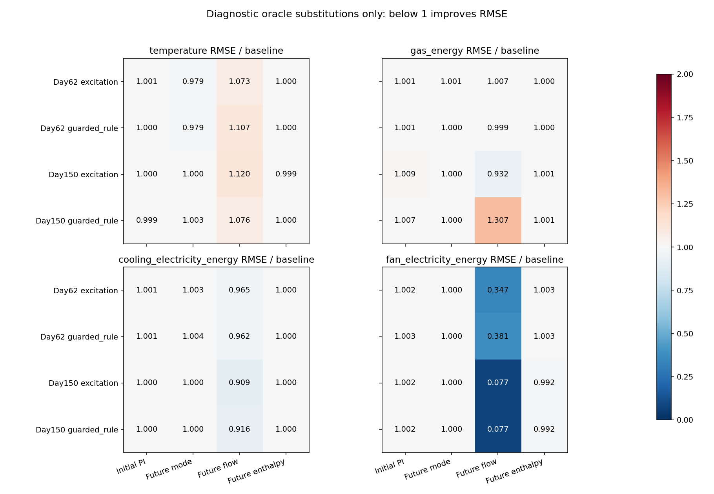
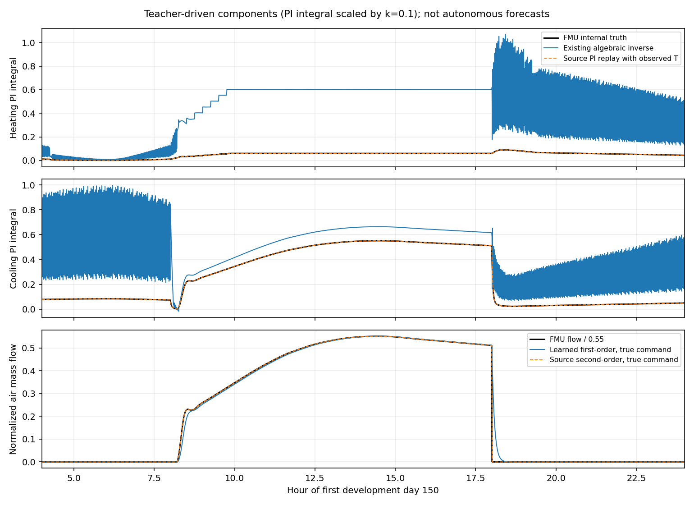

# 一轮限定末端诊断：优先修正风量前向动态

本轮完成预定的PI状态恢复、冷却切换、风量和焓差核对，以及**原模型＋四个单因素诊断替换**。没有训练新参数、增加网络/RL、修改能力门、运行新场景或采新校准。原生联合模型仍没有部署资格，规则控制保持主基线。[实验协议](../../docs/experiments/terminal_diagnostic.md)在采集和诊断前固定。

主要发现：**风量前向动态是优先排查项；PI反推确实失真，但只修起点状态不足以改善长预测；当前场景的焓差近似和日程端点不是主要误差来源。** 这是开发诊断结论，不是控制升级或真实迁移结果。

## 范围和验证方法

基线`ee888c4`。保持上一轮`native_joint`的14个参数、30秒热网络/观察器和900秒动作不变；模型SHA `71de604f98e68f599f55f5b479866707857660b26eb83f76989080ded476517d`。旧住宅、办公室和末端模型/源码冻结链全部有效。

仅重放已有丹佛办公室day62/150的规则和激励四支3天开发回合，完整重放**1,152次动作、34,564个原生点**。两日期各有两策略，共12天评测运行、6个天气日历日；每回合另有6天预热＋1天22°C共同预序列，失败试采另计，不能把12天称全部计算成本或独立天气样本。FMU、天气、参数、动作与求解器均不变，只扩展PyFMI结果过滤器记录内部变量。

四支公开温度、供暖/制冷/风机功率、风量和动作与原开发轨迹**逐值一致**后，才读取对应内部信号。固定BOPTEST 0.9.0、上游`9b1610bf7a108826bb3d22c72bffd2d71d7bb0a9`、原`bestest_air` FMU；复用原固定worker镜像，隔离容器以`--network none`运行，不修改在线worker或FMU。第三方许可沿用[部署记录](../../docs/experiments/simulation.md)，本轮不分发FMU和完整内部轨迹。

每回合前4小时用于状态预热，之后每小时一个起点，各63个重叠6小时窗口，共252个起点。报告30秒、5/15分钟、1/6小时温度、燃气/制冷电/风机电功率及累计能源；[700行指标](metrics.csv)、[1,260行同起点6小时误差](paired_6h_errors.csv)及[完整结果表](results_table.md)保留全部改善和退化。

| 诊断替换 | 固定只改什么 | 信息限制 |
| --- | --- | --- |
| baseline | 原生联合模型原样运行 | 与上一轮140行基线指标精确一致 |
| initial_PI_oracle | 起点两路积分改为FMU内部真值 | 当前接口不可观测；未来积分不回填 |
| cooling_mode_oracle | 模式改用实际未来冷却迟滞状态 | 含未来信息，只用于诊断 |
| flow_oracle | 风量改用实际未来质量流量 | 含未来信息，只用于诊断 |
| enthalpy_correction_oracle | 功率中加入真实流股焓差与定比热温差的差值 | 含未来信息，只用于诊断 |

所有预测窗的热状态仍自由滚动，没有回填未来实测温度或功率；除对应oracle字段，其他逻辑/参数一致。内部真值不进入训练，也没有组合oracle后再选“最优模型”。这些替换不能拿来通过原能力门或报告节能率。

## H1：PI代数反推丢失饱和状态，得到支持

FMU两路PI为`k=0.1、Ti=120s、Ni=0.9`；当前学习等效值为`Ti≈42.07s、Ni≈0.315`。饱和输出相同可以对应多个积分状态，从功率/风量反推时把受限输出当成未饱和PI，无法唯一恢复积分记忆。

以比例增益缩放后的积分贡献为单位，既有反推在四支回合的供暖/制冷积分RMSE分别为**0.2578～0.3940 / 0.3659～0.5832**；81.8%～88.9%的两路状态样本误差超过0.05。用实测历史温度、已执行动作和源PI方程作1秒步长前向重放，从内部初态开始，RMSE仅6.1e-6～1.61e-4；从零积分开始、经过4小时历史后，供暖最大约0.00910，制冷最大约3.45e-5。[分项核对](component_checks.json)保留全部值。

反推误差还包含风量滤波和等效功率参数影响；本组消融没有把这些来源唯一分解，不能把全部误差都归给饱和。

这表明“沿已发生历史恢复状态”比当前代数反推更合适。但**仅把预测起点积分换成真值，6小时误差几乎不变**；未来仍使用原等效PI/风量动态，起点修正很快被后续动态主导。不能因此宣布只换初始化即可解决模型问题。

## H2：迟滞和日程大体对应，端点需明确

按实测温度和公开日程重建−1/0K迟滞，四支回合各8,161个诊断点只出现2/2/3/3个模式不一致；每支各6个冷却设定值差异，均位于每天08:00、18:00的日程边界。[端点清单](additional_equation_checks.json)完整保留，没有删点或改原轨迹。

这是FMU记录端点的左极限与当前日程函数右连续值的区别。未来模式oracle对冷季温度有小幅帮助，暖季整体变化很小；不支持把本轮主要功率偏差归因于日程整体错位。也不能用实测温度下的模式吻合证明模型自身预测温度下始终切换正确。

## H3：一阶风量与源二阶滤波不匹配，优先处理

编译FMU明确`use_inputFilter=true、order=2、riseTime=30s`，两实极点均约`−0.25948784 s⁻¹`。滤波状态是归一风量，满足：

```text
dx1/dt = λ(command - x1)
dx2/dt = λ(x1 - x2)
mass_flow = 0.55 * x2
λ = 0.25948784 /s
```

与编译FMU保存的导数及输出核对，最大残差约5.6e-17。原模型却用约274.15秒的一阶状态。这里的30秒上升时间、单个极点时间常数及拟合出的274秒不能互换解释。

在相同真实风机命令驱动下，一阶模型归一风量RMSE为**0.01370～0.02151**，源二阶重放为**0.001287～0.002242**。后者仍受30秒命令采样插值和事件影响，不称完整连续控制器已精确恢复。给定真实风量时，现有风机功率映射RMSE约**1.42～1.84W**，进一步支持先查前向风量、再查功率映射。

最有辨识力的单因素替换是未来风量：规则轨迹6小时风机电量RMSE冷季**0.025738→0.009815kWh**、暖季**0.099868→0.007696kWh**。这是预测误差下降，本轮没有闭环节能率。

但温度RMSE同时冷季**0.528901→0.585362°C**、暖季**0.484290→0.521249°C**；暖季燃气也从0.036353增至0.047504kWh。制冷误差虽下降，仍明显存在。说明风量改善不会自动使整个耦合模型变好；参数补偿或热网络/离散表达问题仍需后续验证，不能把风量认定为唯一根因。

## H4：流股焓差应使用正确位置，当前定比热误差较小

`FanCoilUnit_T.mo`的计量式用**送风出口焓－区域回风流股焓**，不能用风机之后的盘管入口焓替代外部回风流股。使用正确流股后，`m*(h_supply-h_return)`与`0.9*GasPower-3*CoolingElectricPower`的四回合最大残差约**8.88e-16kW**。

当前`1006 J/(kg·K)`定比热温差式在活动流量时的热功率RMSE为冷季约**3.28～3.34W**、暖季约**6.60～6.78W**。记录的盘管入口/出口水质量分数一致；本轮没有单独保存外部回风湿度，不能把盘管入口湿度当成外部回风湿度，也不能据此推广到其他湿工况。

加入真实焓差修正后，6小时温度和制冷电量误差基本不变。正确处理焓值位置仍是必须的物理约定，但本轮证据不支持把它列为主要修复优先级。





## 必要验证与采集失败

- **112项测试通过**，新增8项覆盖原基线一致性、oracle字段隔离、起点PI不读取未来积分、预测不回填未来温度/功率、焓差单位、二阶滤波阶跃及饱和不可辨识。
- 四支原3天开发回合完整公开轨迹逐值重放一致，共1,152次动作、34,564点；不是只重复前缀，也不是重复正式测试。所有非供暖覆盖保持关闭，动作、原生能源/温度指标与原开发记录一致。
- 独立重算得到的700行指标、1,260行同起点误差及部件检查逐字节一致；原生联合模型140行基线指标与上一轮精确一致。滤波方程和外部流股能量式独立核验通过。
- 首次独立`TestCase`缺少工作目录的`version.txt`；修正后又发现PyFMI把数组名方括号当通配符，已转义。首点采集曾取新动作写入后的瞬时值，修正为动作前左端点，并用round-trip解析原CSV。失败采集目录/日志保留；Windows拒绝重命名后，失败目录留在原位，成功重放使用独立新目录，没有混用失败轨迹。
- 源表达核对时纠正了盘管入口与外部回风焓的区别、归一滤波状态与系数的区别，在正式固定消融前通过导数/能量闭合验证。没有据消融结果追加候选、训练参数或调整能力门。详见[失败台账](collection_failures.json)、[审计](audit.json)和[来源摘要](provenance.json)。

## 本轮结束和后续边界

**预定诊断已完成，本轮到此结束。** 没有部署候选、没有新校准/新场景；保持规则控制及所有旧结果。完整内部数据位于`outputs/terminal-diagnostic-replay`，分析/重算位于`outputs/terminal-diagnostic-analysis`和`outputs/terminal-diagnostic-recompute`；内部数据与模型二进制不入Git。

下一轮唯一优先事项：**先验证与源PI、二阶风量一致的因果末端前向模型，再讨论热网络/能量联合重拟合。** 先用过去温度/动作恢复状态，限制模型从真实部署接口取信息；不得把这里的未来风量/模式/焓值oracle拿去控制。此次诊断不等于该修复已经实施，也不等于原能力门已通过。

本轮仍在阶段3迁移失败后的模型诊断中，补前序模型基础；没有真实楼宇或已验证Sim-to-Real成果。

复现需要既有原开发工件及固定源/worker镜像，目录必须不存在；四支重放与分析仅依赖本地文件。容器挂载项目目录为`/workspace`后执行`/miniconda/envs/pyfmi3/bin/python /workspace/scripts/collect_terminal_diagnostic.py`。分析与核验命令：

```powershell
.venv-cpu/Scripts/python.exe -m thermal_comfort.terminal_diagnostic
.venv-cpu/Scripts/python.exe scripts/verify_terminal_diagnostic.py
.venv-cpu/Scripts/python.exe scripts/report_terminal_diagnostic.py
.venv-cpu/Scripts/python.exe -m unittest discover -s tests -v
```
