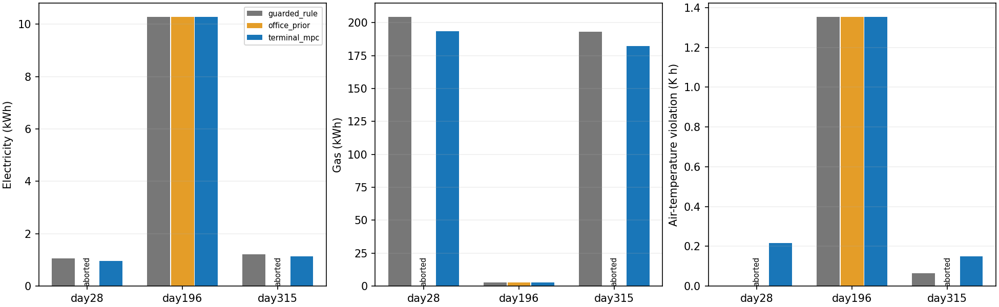
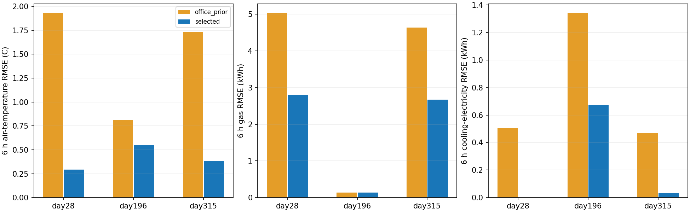

# 冷暖季末端数据、未触碰校准与新气候场景

**本轮对规则与旧模型均为0/9组通过整体门槛。** 新数据模型在新气候的规则轨迹上预测更准，但冷季MPC少耗能的同时增加过冷，暖季基本等于规则。开发锁之后才生成校准数据，之后没有改模型、裕量或控制；未触碰校准流程完成，不代表闭环约束可靠。

## 数据与验证对象

原冻结基线为`11a704e`的丹佛办公室模型。新丹佛办公室训练day24/94/124/328各3天，选模day62/150各3天，校准day74/240/312各3天。开发角色连同6天内置预热＋1天22°C预序列均隔离，并避开全部原丹佛办公室窗口。角色跨季节交错，是时间分块隔离，不称全年先后排序或未来年度预测。

正式泛化对象为此前没有运行过的**48 m²办公室＋布鲁塞尔TMY天气**组合，测试day28/196/315，三种预报、三个控制器，计划27支七天。气象文件曾用于住宅，本轮不是新气象年度，也不是新建筑实体。FMU只替换实际气象mos、预报weather.csv和案例名称，二进制、围护结构、末端、人员/内部得热日程不变；源和目标摘要及逐文件差异见[场景清单](scenario.json)。原生纬经度与天气供体核验，实际/预报天气及太阳几何偏差独立报告。

所有对照只覆盖供暖设定值18～23.25°C，0.5K/15分钟限速；冷却、风机和送风保持共同内置控制。旧办公室MPC只统一前16步规则初始化，其权重/原裕量和其余策略保留。新模型的预测统计也从第16步开始，避免把未评估初始化起点当已验证。目标是空气温度和官方温度带，不是主观热舒适或住宅操作温度。

## 模型选择：动态候选没有胜出

新采18天开发激励，1,728转移、51,846个30秒原生点；最终模型拟合只用12天、1,152转移。变长1/2/4/8步供暖激励采集区间平均和端点功率，低温20°C恢复，18～35°C中止带保持。原21天目标数据及全部旧测试没有用于本轮拟合、选择或调参。

空气/蓄热热网络、0.9供热效率和3倍冷却COP保持同一物理定义。新动态候选分开预测区间平均/下一端点，使用过去端点记忆和当前动作变化；平均/端点都用凸一阶滞后，时间常数10～1800秒，能源有界非负。初版多项自回归记忆没有胜出，保留失败源码/模型。最终候选按两个季节等权的1/6小时温度RMSE均值＋6小时燃气/制冷电量RMSE选择，单位分别按1K、1kWh归一；评分在校准前固定，模型不根据新测试重选。

| 候选 | 残差权重 | 开发联合分数（越小越好） |
| --- | ---: | ---: |
| 新数据静态末端 | 0 | **2.441640，选中** |
| 新数据静态末端 | 1 | 2.521448 |
| 凸一阶滞后动态末端 | 0 | 2.572744 |
| 凸一阶滞后动态末端 | 1 | 2.581916 |
| 初版多项自回归候选（另存失败版本） | 0 | 2.758393 |

最终部署为**同数据重拟合静态模型、残差权重0**。不能把已尝试动态建模表述为动态算法已胜出。旧3天模型在这两段选模激励上的平均联合分数约3.033960；新方案改善冷季燃气，但暖季冷却与温度仍较弱。

| 选模回合/指标 | 旧办公室模型 | 新选中模型 |
| --- | ---: | ---: |
| day62 6小时燃气RMSE kWh | 3.523784 | 1.394694 |
| day150 6小时制冷电量RMSE kWh | 0.919052 | 1.543520 |

完整[选模分项](fit_selection.json)、[初版失败](autoregressive_development_failure.json)与[有效参数](model_parameters.json)归档。此评分的能源权重、回合数与动态先验均有限，不能把某一候选的未胜出外推为动态模型无用。

开发控制六支共1,614转移、48,426原生点，五支完整，旧办公室MPC在day62触发中止（17.967335°C）；规则和新方案两日期都完整。首次新控制器初始化漏合并物理参数造成KeyError的失败版本亦保留，之后修复、加入测试并重跑。截断旧基线的累计量不作完整回合比较。

四支20.5/23.25°C成对半天干预额外192转移、5,764原生点。首小时温度/燃气方向正确，幅度仍偏差明显：冷季6小时燃气差实测3.179894kWh、预测6.768273kWh；暖季实测1.468161、预测2.626147kWh。冷却反馈后的温差轻微反向和制冷电量响应也保留，不再要求全时域温度单调，不将方向检查当能耗幅度已可靠。

## 未触碰校准与可行性

2026-10-25 **19:51:15北京时间先锁定开发方案**，绑定模型、控制器、工况、标定算法、配置/协议与开发证据；19:51:16之后才创建校准数据。锁后拟合和控制开发入口拒绝执行；每支校准前复核锁。最终权重与开发验证权重、独立重训均逐字节相同，后续截断读入完善没有修改已验证控制行为。见[开发锁](development_lock.json)、[校准创建清单](calibration_manifest.json)与[开发审计](control_development_development_audit.json)。

9天校准全新生成、全部完成，共864转移、25,923原生点，不参加参数拟合或开发诊断。按当前测得端点功率和已知冷却日程划分供暖/制冷/空载/切换；若窗口含冷却设定切换优先归切换，不看未来真实功率或越界标签。逐步下/上侧温差q95各加0.1K；少于20起点的格子自动回退同一步长全池，未裁小裕量以制造可行性。

| 6小时工况 | 起点数 | 是否回退全池 | 下侧K | 上侧K |
| --- | ---: | --- | ---: | ---: |
| 供暖 | 12 | 是 | 1.088703 | 3.066623 |
| 制冷 | 25 | 否 | 0.141617 | 2.571508 |
| 空载 | 47 | 否 | 1.449941 | 0.422441 |
| 日程切换 | 99 | 否 | 0.777225 | 3.088615 |

供暖分层仍稀疏，不能因采到冷季就称每格充分。单侧经验95%不是双侧95%、整段联合覆盖或概率安全证书；183个起点有重叠，也非独立随机样本。所有1/4/24/32步计数/稀疏标志见[margin_table.csv](margin_table.csv)。

校准激励实际状态上的影子计划共816步：254步以空收紧带拒绝、125步无可行计划、244步超出支持，193步有可行计划（含参照）。供暖全池与切换上侧裕量较大，收紧带仍可能为空。这是沿激励状态的离线计划诊断，不是校准闭环收益；没有用这些结果改分组、阈值、模型或控制。完整[校准审计](calibration_audit.json)与[分工况预测/覆盖](calibration_prediction_metrics.csv)保留。

**19:52:29最终冻结后才开始新场景。** 模型SHA `33e4a46c4e6e70c8a56010ff3c2630813d584d4d5265ef09812309e0081f6ac8`，校准裕量独立保存且写入一次。[冻结清单](freeze.json)绑定开发锁、校准清单/原始摘要、裕量与审计；原住宅和办公室冻结文件仍有效。

## 新场景结果

27个计划回合中21个完整：规则和新方案各9个全完成，旧办公室MPC仅夏季3个完整；冬季3个在77步、过渡季3个在98步中止。实际共**14,637条转移、439,137个原生点**，没有按计划长度虚报18,144条。全部截止时间、失败原因和累计值见[九组全表](results_table.md)、[逐组验收](acceptance.json)。

以下为完美预报的**规则→新方案**完整七天对照，旧模型截断量不并入此表。

| day | 电量kWh | 燃气kWh | 总温度越界K·h | 新增过冷K·h |
| --- | ---: | ---: | ---: | ---: |
| 28 | 1.050841→0.958901 | 204.611938→193.445525 | 0→0.217306 | 0.217306 |
| 196 | 10.283923→10.283925 | 2.684940→2.684948 | 1.354147→1.354148 | 0 |
| 315 | 1.221883→1.143379 | 193.096569→182.107510 | 0.065425→0.149416 | 0.083991 |

day28少电8.75%（仅0.091940kWh）、少燃气5.46%，但新增过冷0.217306K·h、0.9333小时、最大0.946081K，未达“温度越界不增”。day315完美预报少电6.42%（0.078504kWh）、少燃气5.69%，却新增过冷0.083991K·h、0.5833小时，最大0.231369K，也未达标。偏冷预报的day315结果稍有变化，仍失败，完整表未省略。暖季电/燃气只有微小数值差，未获实质收益。

旧MPC六个中止组不能做完整周能耗排名；其余夏季三组与新方案基本一致，没有严格节电。相对旧模型的0/9包含六组不可完成对照，而不是新模型比中止基线更耗能的证明。所有验收保持1e-6容差、冷热分项/时长/最大偏差和分能源不增规则，没有因失败放宽门槛。



### 离线预测与闭环分布

沿相同完整规则轨迹、完美API视图的6小时条件预测如下；旧模型的离线预测可以沿规则状态评估，与它自身闭环中止是两种不同证据。

| day | 旧→新温度RMSE °C | 旧→新燃气RMSE kWh | 旧→新制冷电量RMSE kWh | 新模型双侧端点覆盖 |
| --- | ---: | ---: | ---: | ---: |
| 28 | 1.930→0.292 | 5.032→2.797 | 0.505→0 | 98.73% |
| 196 | 0.816→0.552 | 0.136628→0.137931 | 1.341→0.674 | 94.27% |
| 315 | 1.734→0.383 | 4.635→2.676 | 0.468→0.035 | 100% |

新模型温度与制冷预测在这三日期改善，冷季燃气改善，暖季燃气没有改善。冷季燃气6小时RMSE仍约2.7～2.8kWh，成对干预能耗幅度偏差也较大，不能说能源模型已可靠。所选模型仍为测试前确定的静态候选，没有按这些测试改选动态模型。



新模型沿**自身MPC轨迹**的6小时温度RMSE为0.548/0.552/0.566°C，双侧端点覆盖86.62%/94.27%/89.17%；冷季/过渡季明显弱于规则轨迹的98.73%/100%。这记录了闭环状态/动作变化下的误差与覆盖退化，不能仅凭规则离线结果判断模型控制可用。单侧q95并不宣称双侧95%或整周安全，偶发关键端点也不能用平均RMSE掩盖。

预测从第16步后每4步取一个起点，完整回合157起点，1/4/24/32步自由滚动；仅已记录的未来动作作为条件输入，不回填未来真实温度、功率或PI状态。完美/传入偏置、控制轨迹、工况及是否截断均列示于[1,668行完整指标](prediction_metrics.csv)。这些起点、日期和偏置有相关性，不当作独立随机楼宇样本。

### MPC可行性

共同前16步之后分母为656步；新方案全九组回退68.29%～79.88%。完美预报的回退为79.42%/68.29%/78.35%，实际动作区别于同状态下限速规则的比例18.75%/28.51%/20.12%；没有发现标记MPC却同限速规则的步骤。动作不同不等于末端功率改变，夏季仍有许多不同供暖设定但实际不供热的步骤。

新方案实际轨迹上至少一处未来收紧带为空的比例为59.60%/43.29%/59.60%；同一日程用旧固定对称裕量为48.02%。分工况并未普遍消除空约束；这只是约束宽度诊断，不是控制消融或安全性排名。空带、支持拒绝、非空但候选不可行和选择参照分别保留于[决策重放](decision_audit.json)与[约束诊断](constraint_diagnostics.csv)。

## 验证与局限

- 95项离线测试与编译检查通过；最终训练/独立重训各候选、选择与临时开发裕量逐字节一致，锁/校准/最终冻结摘要均通过。校准严格在开发锁后生成，未用于结构诊断或调参。
- 全部14,637个实际正式决策重放，动作、限幅/限速、非供暖覆盖关闭、共同预序列/前16步和规则跨预报不变性核验通过。数据审计通过不等于闭环性能通过。
- 30秒原生KPI独立积分含同一共同预序列，与API最大绝对差8.882e-16；正式表另排除该一天。新方案原生空气温度18.360～27.722°C，未触发18～35°C中止带但存在官方舒适带过冷；全部策略含失败基线最低17.897°C。
- 27支独立首6小时共648步、19,467原生点与正式前缀严格一致，未重复完整七天。原基线中止均晚于6小时，故本轮全部前缀实际满24步。
- 首次日报审计把中止后的空表交给积分器而报错，保留日志和当时审计源码。仅修正只导出实际时段，未更改轨迹/模型/裕量；最终日报150个完整日、6个部分日，部分日标明观测小时，未填零冒充完整日。
- 新天气实际纬经度与供体一致，示例原生/预报最大差约0.047K、1.87W/m²，太阳天顶角/太阳时对供体CSV分别约5e-12rad/5e-6s；这些是时间采样/预报一致性诊断，不是模型预测误差。来源FMU的二进制/物理日程未变，两张图已逐一检查。

只用一个办公室、两个TMY气候组合和三个新测试日期，没有新气象年度、真实建筑数据或真实闭环。内部得热日程视为已知，气象误差只是合成偏置，热量依赖固定效率/COP换算。有效热网络参数/潜在状态没有被验证为真实墙体物性；本轮只标定温度裕量，分能源不增筛选仍基于点预测，未建立能源误差安全界。所有原始模型、轨迹、失败源码保留`outputs/terminal-*`；紧凑来源、环境与摘要见[provenance.json](provenance.json)。

下一步保持规则为主要控制基线。先在新开发流程中评估原生时间尺度的末端辨识、温度/功率联合多步训练及按季节/能源的能力门；工况可探索过去窗口统计以减少端点循环功率造成的稀疏分类，但需新的未触碰校准验证。不能回到本轮数据改完再称盲测，也不能用更大网络或更宽温度带承诺节能。

## 复现顺序

先按旧协议恢复原冻结资产与BOPTEST服务；以下输出必须不存在，旧结果应另行保留。准备新案例只做资源复制/提交，不在冻结前试跑新测试日期。

```powershell
.venv-cpu\Scripts\python -m thermal_comfort.terminal prepare
wsl -d Ubuntu-24.04 -u root -- docker compose -f /mnt/d/thermalComfortPredict/infra/boptest.compose.yml run --rm -v /mnt/d/thermalComfortPredict/outputs/terminal-scenario/testcases:/terminal:ro provision python3 -m boptest_submit --shared --path /terminal
.venv-cpu\Scripts\python -m thermal_comfort.terminal collect --output outputs/terminal-development
.venv-cpu\Scripts\python -m thermal_comfort.terminal fit --output outputs/terminal-model
.venv-cpu\Scripts\python -m thermal_comfort.terminal fit --output outputs/terminal-refit
.venv-cpu\Scripts\python -m thermal_comfort.terminal validation --output outputs/terminal-validation
.venv-cpu\Scripts\python -m thermal_comfort.terminal response --output outputs/terminal-response
.venv-cpu\Scripts\python scripts/verify_terminal.py development
.venv-cpu\Scripts\python -m thermal_comfort.terminal lock
.venv-cpu\Scripts\python -m thermal_comfort.terminal collect-calibration --output outputs/terminal-calibration
.venv-cpu\Scripts\python -m thermal_comfort.terminal calibrate
.venv-cpu\Scripts\python scripts/verify_terminal.py calibration
.venv-cpu\Scripts\python -m thermal_comfort.terminal freeze
.venv-cpu\Scripts\python -m thermal_comfort.terminal test --output outputs/terminal-control
.venv-cpu\Scripts\python -m thermal_comfort.terminal test --days 0.25 --output outputs/terminal-repeat
.venv-cpu\Scripts\python scripts/verify_terminal.py test
.venv-cpu\Scripts\python scripts/report_terminal.py
```
