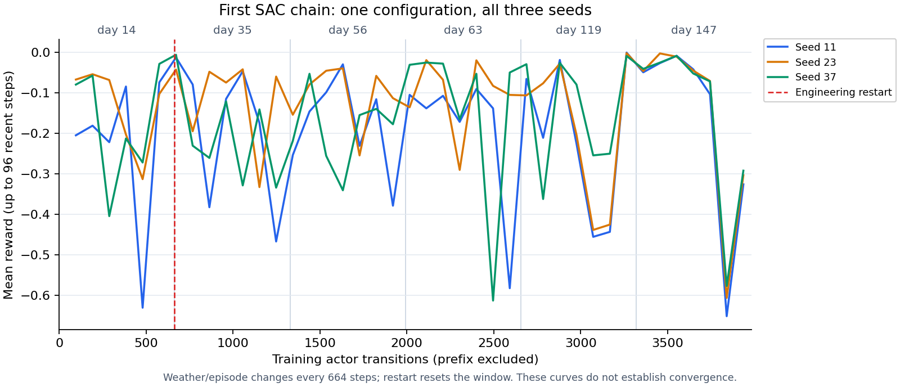

# V2-3：SAC首次训练与开发链路

**三种子已跑通训练、保存、重载和开发评估；这是含一次工程续跑的首轮链路验收，尚无稳定优于第一版的证据。** 不授予留出评估或工作台控制资格。只完成V2-3的首个算法小预算验证，PPO/TD3及正式主比较未执行。

## 为什么做、怎么做

在原BOPTEST住宅、同一FMU/气象年中，检验连续控制SAC能否利用12小时天气预报及历史状态，在温度越界不增加的前提下少用电。比较参照是[V2-2同协议重跑的冻结规则、MPC及最小供暖](../v2_2/REPORT.md)，不直接挪用早期不同场景的节电率。

- 学习前固定[协议](../../docs/experiments/v2_sac.md)、[配置](../../configs/v2_sac.json)和[登记](registration.json)：一套参数，种子11/23/37，六个训练日期14/35/56/63/119/147各一遍；最终检查点在84/168/189确定性评估，不按开发挑检查点或最佳种子。
- SAC使用SB3 2.9.2、64×64 MLP、经验回放和自动熵；每种子3,984条actor训练转移、3,728次梯度更新。固定503维物理缩放，无拟合统计量。CPU每进程一线程，三个独占同环境副本，不使用GPU或云训练。
- 动作是供暖设定变化，限18～23.25°C、0.5K/15分钟；加入预登记低/高温滞回规则保护，原始建议、投影和实际执行分别保存。这是SAC加规则保护的组合，不能保证舒适或主动制冷。
- 奖励惩罚电量、冷热越界、动作变化和回退；评分仍独立检查电量与六项温度指标，奖励好不等于门通过。7天预热、7天计分、共同8步规则前缀计分但不进经验池；有限任务终止与外部截断分开。
- 三种子共27次select/显式initialize、18,144次advance，544,347个原生点；训练actor 11,952、开发5,976、共同前缀216步。预算未增加，所有调用成功，27次stop成功；上游标准time0/warmup0构造bootstrap单独披露，不读取/推进/计分其轨迹。

## 工程故障与证据限制

三支均在首个train014完成后导出失败：SB3自动给info加入NumPy终止观测，JSON导出未过滤。保留原失败、原源码、检查点和经验池，在任何开发采集前登记[一次工程修复](../../docs/experiments/v2_sac_repair.md)，将终止观测单存NPZ，补回归后从原664步检查点继续其余五训练与三开发回合，**没有重跑首回合或补交互预算**。[修复清单](engineering-repair.json)及[源码差异](engineering-repair.diff)可追溯原登记。

actor/critic/熵参数、三组优化器及经验池恢复核验通过；但原程序没保存RNG状态，加载重置随机流，故**不是未中断训练的逐位续跑，也不能作为原未中断方案的正式性能证据**。每支续跑后状态单独记录，不能把三种子记成一次无故障正式比较。

三个首训练回合保有原生数据、动作/奖励、观测及完整经验池；官方KPI响应值与末预报未成功归档。代码/调用账本显示导出前现场核对已执行成功，但缺失值不能事后补称已保存。摘要按原生轨迹离线恢复，明确标记`kpis=null`；其他15个训练回合及全部9个开发回合的官方KPI均完整。缺失3项与有效24项分别报告。

## 开发结果

表中单位为电量kWh、冷热越界K·h；完整六项温度门、终态差、各原生档案摘要及最小供暖对照见[机器结果](summary.json)。相同日期的种子不是独立天气重复。

| 日期 | 冻结规则：电量/过冷/过热 | 冻结MPC：电量/过冷/过热 |
| --- | --- | --- |
| 84，有效供暖 | 245.186 / 0 / 0 | 235.841 / 0 / 0 |
| 168，较暖有效供暖 | 8.773 / 0 / 4.914 | 6.579 / 0 / 4.711 |
| 189，零负荷/无主动制冷 | 0 / 0 / 292.695657 | 0 / 0 / 292.696551 |

| 种子 | 日期 | SAC电量 | 过冷 | 过热 | 相对规则/MPC联合门 |
| --- | --- | --- | --- | --- | --- |
| 11 | 84 | 268.856 | 0 | 0 | 均未过 |
| 11 | 168 | 20.505 | 0 | 8.952 | 均未过 |
| 11 | 189 | 0 | 0 | 292.697096 | 均未过，原严格门保持 |
| 23 | 84 | 254.863 | 2.247 | 0 | 均未过 |
| 23 | 168 | 43.688 | 0 | 16.885 | 均未过 |
| 23 | 189 | 0 | 0 | 292.697099 | 均未过，原严格门保持 |
| 37 | 84 | 248.465 | 0 | 0 | 均未过 |
| 37 | 168 | 5.538 | 0 | 4.630 | 均通过 |
| 37 | 189 | 0 | 0 | 292.697180 | 均未过，原严格门保持 |

全部9支开发回合额外回退率0，无工程中止或机械违反。有效供暖的6个“种子×日期”仅1个同时胜过规则和MPC；种子37/168分别节电36.88%/15.83%，但不能挑该支声称稳定提升。其他种子暖季耗电/过热更大，种子23冷季还出现过冷。没有种子在全部开发条件通过。

189不报节电百分比。其严重过热约292.7K·h仍无法主动消除；约0.0014K·h的相对规则微差按原门仍失败，但结合[先前数值诊断](../v2_3_numerics/REPORT.md)，不能解释为物理控制收益。原失败、1e-6K·h等容差均保留。



曲线为最多最近96步的均值；日期每664步变化，续跑时滚动窗口重置。仅3,984步/种子，图不能证明收敛，也不足以否定SAC潜力。

## 验证与成本

- 完整回归：`python -m unittest discover -s tests -v`，**264项通过，21.689秒**。新增14项覆盖权限/预算、固定缩放/因果观测、奖励/保护、SB3终止占位reset、重载及终止观测导出回归；工程修复前的13项未覆盖真实库info原地变更，失败按上节保留。
- [轨迹独立审计](archive-audit.json)：18,144条原生转移、5,976条开发策略预测全部重放；实际动作/因果观测/开发预测差0，经验池仅含训练，6个terminal/种子、0timeouts，评估前后权重/经验池/步数不变。24份官方KPI核对最大差5.68e-14，首训练3份响应缺失单列。
- [优化器审计](optimizer-audit.json)：六个初段/最终检查点中actor/critic/熵优化器序列化与加载状态逐项相等，更新计数分别408/3,728；只读检查，无新增训练或FMU调用。
- 从最初登记到结果文件约21.1分钟，包含故障与修复暂停，不是纯训练耗时；续跑段每种子493.1～494.6秒，不含首回合和修复暂停。逐接口耗时/预算、缺失首回合墙钟等在summary记录；推理独立耗时和CPU进程时间未归档，不能声称相应速度优势。
- 四层父锁、V1模型/FMU、数据角色与原比较门保持；留出/旧保护窗口初始化0。三个本轮Compose副本已关闭，原工作台8768/8770会话ID/状态未改变。

## 如何复核与继续

小型配置、源码、协议、曲线与摘要在Git；模型、回放池、全量原生/预报/账本及原失败在`outputs/v2-sac/`，未上传大文件。此轮新资产尚未加入V1既有异地备份，不继承F03恢复认证。

公开登记/审计JSON统一为LF文本；私有原登记/修复文件的字节SHA在summary另列，原内部引用保留。核对这些引用时应使用私有原文件，不能拿文本归一化后的公开副本直接代替其原字节哈希。

已有本轮私有档案时，以下都是只读命令，不启动仿真：

```powershell
outputs/v2-sac/env/Scripts/python.exe -m scripts.verify_sac outputs/v2-sac/live-registered --output outputs/v2-sac/archive-audit-recheck.json
outputs/v2-sac/env/Scripts/python.exe -m scripts.check_sac_checkpoint outputs/v2-sac/live-registered --output outputs/v2-sac/optimizer-audit-recheck.json
outputs/v2-sac/env/Scripts/python.exe -m scripts.plot_sac outputs/v2-sac/live-registered --output outputs/v2-sac/learning-curve-recheck.png
```

干净源码可用`requirements/sac.txt`接入已有RL运行依赖；Windows/Python3.14完整锁为`requirements/sac-windows-py314.lock.txt`。原生复核还依赖旧基线私有资产，源码克隆不包含完整实验权重。`run_sac register/seed/summarize`提供新登记、逐种子训练和汇总入口，但会消耗新预算，须下一轮明确登记后执行；当前代码直接无故障重跑不会复现本轮分段随机轨迹。`verify_sac`针对本轮含修复的既有档案，不能冒充通用无故障复现实验。

下一步先补齐完整RNG保存恢复验收（或预注册失败即停、不续跑），再冻结SAC/PPO/TD3正式比较的共同交互预算、奖励/信息/动作/保护与检查点规则。本轮小预算链路完成，不自动加训练配置、网络、日期或留出；开发不达标则保留规则/MPC和负结果。全部第二版交付仍以[路线图](../../ROADMAP_V2.md)为准。
